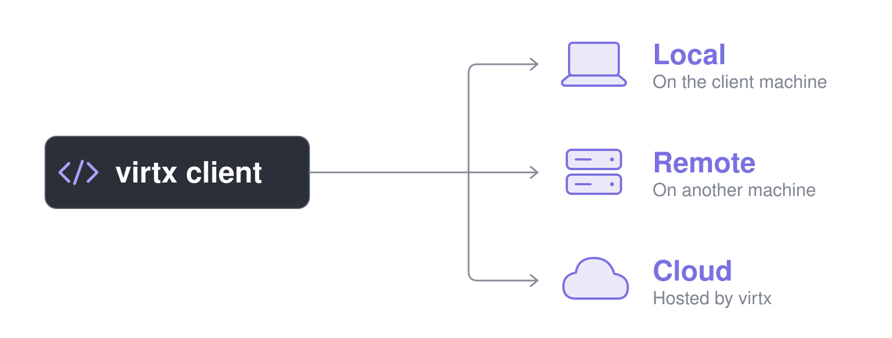
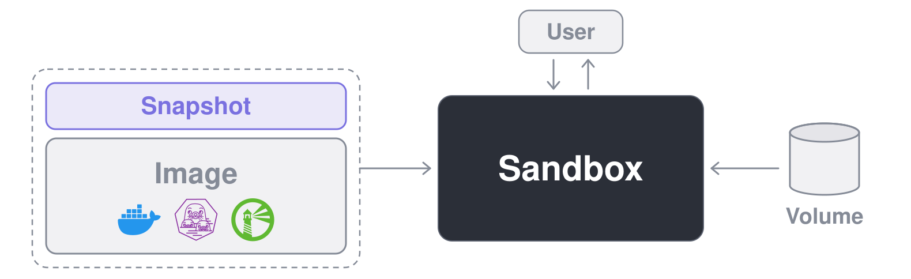

<p align="center">
  
  
</p>

<h3 align="center">コードとAIエージェントのための使い捨てLinux VM</h3>

<p align="center">
   <a href="https://pypi.org/project/virtx/"></a>
   <a href="https://www.npmjs.com/package/@brekkylab/virtx"></a>
   <a href="https://crates.io/crates/virtx"></a>
</p>

<p align="center">
  <a href="https://discord.gg/27rx3EJy3P"></a>
  <a href="https://x.com/brekkylab"></a>
</p>

<p align="center">
  <a href="README.md">English</a> · <a href="README.zh-CN.md">简体中文</a> · <b>日本語</b> · <a href="README.ko.md">한국어</a>
</p>

<br>

virtxを使うと、自分のコードから使い捨てのLinux VMを立ち上げてタスクを実行できます。

手元のマシンには入れたくない重い依存関係が必要な処理や、AIエージェントが自分の判断で実行するコマンドのように、そもそも手元で動かしたくないコードを扱うときに役立ちます。
VMの中でインストールしたものや変更した内容はVMを削除すると消え、残るのは保存しておいたスナップショットやボリュームに書き込んだものだけです。

> [!TIP]
> virtxでAIエージェントを作るなら、私たちが開発しているオープンソースのエージェントSDK、[Ailoy](https://github.com/brekkylab/ailoy)もぜひ試してみてください。
> virtxをベースにしていて、エージェントごとに専用のサンドボックスを用意するので、設定なしでコマンドやファイル操作のツールがVMの中で動きます。

## クイックスタート

> [!TIP]
> コーディングエージェントを使っているなら、[virtxスキル](skills/virtx/SKILL.md)をインストールすれば、以下のコードはエージェントが書いてくれます。
>
> ```bash
> claude plugin marketplace add brekkylab/virtx && claude plugin install virtx@brekkylab
> codex plugin marketplace add brekkylab/virtx && codex plugin add virtx@brekkylab
> ```

どのサンプルも、`jq`入りのイメージをビルドし、そのイメージからサンドボックスを起動してコマンドを実行し、出力を表示します。

### ローカル

`Client.spawn()`がローカルサーバーを自動で起動します。

<details open>
<summary><b>Python</b></summary>

```sh
pip install virtx
```

```python
import asyncio

from virtx import Client, ImageJobEnd, Log, Recipe, SandboxJobEnd, Stderr, Stdout


async def main() -> None:
    with Client.spawn() as client:
        recipe = Recipe("alpine:latest").run("apk add --no-cache jq")
        async for entry in client.build_image(recipe, "jq:latest"):
            match entry.entry:
                case Log(line):
                    print(line)
                case ImageJobEnd(error=str(error)):
                    raise RuntimeError(error)

        sandbox = await client.create_sandbox("jq:latest")
        try:
            cmd = ["sh", "-c", """echo '{"hello": "virtx"}' | jq -r .hello"""]
            async for entry in sandbox.exec(cmd):
                match entry.entry:
                    case Stdout(line) | Stderr(line):
                        print(line)
                    case SandboxJobEnd(code):
                        print("exited", code)
        finally:
            await sandbox.remove()


asyncio.run(main())
```

</details>

<details>
<summary><b>Node</b></summary>

```sh
npm install @brekkylab/virtx
```

```js
const { Client, Recipe } = require('@brekkylab/virtx')

async function main() {
  const client = Client.spawn()
  try {
    const recipe = new Recipe('alpine:latest').run('apk add --no-cache jq')
    for await (const entry of client.buildImage(recipe, 'jq:latest')) {
      if ('log' in entry) console.log(entry.log)
      else if ('end' in entry && entry.end.error) throw new Error(entry.end.error)
    }

    const sandbox = await client.createSandbox('jq:latest')
    try {
      const cmd = ['sh', '-c', `echo '{"hello": "virtx"}' | jq -r .hello`]
      for await (const entry of sandbox.exec(cmd)) {
        if ('stdout' in entry) console.log(entry.stdout)
        else if ('stderr' in entry) console.error(entry.stderr)
        else if ('end' in entry) console.log('exited', entry.end.code)
      }
    } finally {
      await sandbox.remove()
    }
  } finally {
    await client.close()
  }
}

main()
```

</details>

<details>
<summary><b>Rust</b></summary>

```sh
cargo add virtx futures
cargo add tokio --features macros,rt-multi-thread
```

```rust
use futures::StreamExt;
use virtx::{
    Client, ImageJobEntry, Recipe, SandboxCreateArgs, SandboxExecArgs, SandboxJobEntry,
};

#[tokio::main]
async fn main() -> Result<(), Box<dyn std::error::Error>> {
    let client = Client::spawn_virtx([] as [&str; 0])?;

    let recipe = Recipe::new("alpine:latest").step("apk add --no-cache jq");
    let mut log = client.build_image(recipe, "jq:latest").log();
    while let Some(entry) = log.next().await {
        match entry?.entry {
            ImageJobEntry::Log(line) => println!("{line}"),
            ImageJobEntry::End(end) if end.error.is_some() => Err(end.error.unwrap())?,
            _ => {}
        }
    }

    let sandbox = client
        .create_sandbox(&SandboxCreateArgs::new("jq:latest"))
        .await?;
    let cmd = ["sh", "-c", r#"echo '{"hello": "virtx"}' | jq -r .hello"#];
    let mut log = sandbox.exec(&SandboxExecArgs::new(cmd)).log();
    while let Some(entry) = log.next().await {
        match entry?.entry {
            SandboxJobEntry::Stdout(line) | SandboxJobEntry::Stderr(line) => println!("{line}"),
            SandboxJobEntry::End(end) => println!("exited {}", end.code),
            _ => {}
        }
    }
    sandbox.remove().await?;
    Ok(())
}
```

</details>

### リモート

サーバーマシンでトークンを発行し、`server.json`でそのトークンを持つユーザーにプロジェクトへのアクセス権を付与します。

```sh
virtx-server-tcp token   # トークンとその token_sha256 を出力
```

```json
{
  "listen": "127.0.0.1:8470",
  "home": "/var/lib/virtx",
  "users": { "alice": { "token_sha256": "<token_sha256>" } },
  "projects": { "demo": { "members": ["alice"] } }
}
```

```sh
virtx-server-tcp serve --config server.json
```

クライアント側では、`Client.spawn()`の代わりにトークンとプロジェクトを指定して接続します。
それ以外はローカルの例と同じです。

<details open>
<summary><b>Python</b></summary>

```python
from virtx import BearerAuth, Client

client = Client.connect(
    "http://127.0.0.1:8470", BearerAuth("<token>"), {"virtx-project": "demo"}
)
```

</details>

<details>
<summary><b>Node</b></summary>

```js
const client = Client.connect(
  'http://127.0.0.1:8470',
  { type: 'bearer', token: '<token>' },
  { 'virtx-project': 'demo' }
)
```

</details>

<details>
<summary><b>Rust</b></summary>

```rust
let client = Client::connect(
    "http://127.0.0.1:8470",
    Auth::Bearer { token: "<token>".into() },
    [("virtx-project", "demo")],
)?;
```

</details>

クライアントが平文の`http`でトークンを送るのは自分のマシンのループバック宛てだけなので、別のマシンで動かすサーバーにはHTTPSで接続するようにしてください。

## 特長

- **信頼できないコードを手元から切り離す:** サンドボックスはすべて独自のカーネルを持つmicroVMで、名前空間だけでなくハイパーバイザーによって隔離され、ネットワークを完全に遮断することもできます。
- **どこで作業していても同じように使える:** どのクライアントも、どのホスト上のどのサーバーとも組み合わせられ、ローカルサーバーからリモートやクラウドへの切り替えも1行の変更で済みます。
  - **クライアント:**  Python ·  Node ·  Rust
  - **サーバー:** 💻 ローカル (stdio) · 🖥️ リモート (tcp) · ☁️ クラウド
  - **ホスト:**  Linux ·  macOS ·  Windows
- **セットアップはほぼ不要:** パッケージを入れればすぐに使え、Dockerも常駐させるデーモンもいりません。
- **いつものイメージがそのまま使える:** Docker Hubや任意のOCIレジストリからpullしたり、レシピやDockerfileからビルドしたりでき、pushし直すことも別のサーバーにコピーすることもできます。
- **シェルを使わずにファイルをやり取り:** サンドボックス内のファイルの読み書き、コピー、削除をコードから直接行えます。
- **サンドボックス内のサービスに接続:** サンドボックス内のWebサーバー、SSH、VNCデスクトップ、データベースに、手元のマシンのアドレスからアクセスできます。
- **前回の続きから再開:** サンドボックスが書き込んだ内容をスナップショットに残して次のサンドボックスに引き継いだり、ボリュームを複数のサンドボックスで共有したり、Notion、Google Drive、OneDriveを普通のファイルとしてマウントしたりできます。
- **GPUも使える:** サンドボックスの中から、ホストのGPUでディープラーニングなどのVulkan処理を実行できます。

## 動作要件

### クライアント

使う言語に合わせて確認してください。

- **Python:** 3.11以降
- **Node:** 22以降
- **Rust:** 1.89以降

### サーバー

ここでの要件は、virtxサーバーを動かすマシンに対するものです。
ゲストは常にLinuxです。

#### ハイパーバイザー

- **Linux**: KVMに対応したカーネル、virtxを実行するユーザーが`/dev/kvm`にアクセスできること、ファームウェアで有効にしたハードウェア仮想化が必要です。
  KVMは最近のカーネルならほぼ標準で組み込まれているので、通常は何もインストールする必要はありません。
- **macOS**: Appleシリコンのみ対応しています。
  VMはOSに標準搭載の`Hypervisor.framework`上で動くので、インストールや有効化の手順は不要です。
- **Windows**: Windows 11以降、x86_64のみ対応しています。
  VMはWindows ハイパーバイザー プラットフォーム（Windows Hypervisor Platform）上で動きます。
  無効になっている場合は、管理者権限のPowerShellで次のコマンドを実行してから再起動してください。

  ```powershell
  Enable-WindowsOptionalFeature -Online -FeatureName HypervisorPlatform
  ```

#### GPU（任意）

GPUを使うサンドボックスの場合だけ必要です。
ホストにはVulkanローダーを、イメージにはゲスト側のVulkanを用意してください。
詳しくは[GPUを使う](docs/content/guides/using-gpus.mdx)を参照してください。

## 仕組み

### クライアント・サーバーモデル

virtxはクライアント・サーバーモデルを採用しています。
クライアント側のコードがvirtxサーバーに何を実行するかを伝え、サーバーがそれをVMで実行して結果を返します。

<p align="center">
  
</p>

サーバーは、コードと同じマシンや別のマシンで自分で動かすこともできますし、マネージドサービスのvirtx cloudを使うこともできます。
どちらの場合もクライアントとサーバーは同じ標準的なHTTPプロトコルで通信し、違うのは通信路だけです。

| | ローカル | リモート | クラウド |
| --- | --- | --- | --- |
| サーバー | `virtx-stdio` | `virtx-server-tcp` | virtx cloud |
| 動く場所 | クライアントプロセスの子プロセス | クライアントとは別のマシン上のデーモン | virtxが運用するマシン |
| 通信路 | stdio経由のHTTP | TCP経由のHTTP | HTTPS |
| 準備 | 不要（インストールも常駐も不要） | サーバーを起動し、ユーザーごとにトークンを発行 | サインインしてAPIキーを作成 |
| 向いている用途 | 作業中のマシンでVMを動かす | より強力なマシンを使う、チームで1台のホストを共有する | 自前のハードウェアなしでVMを動かす |

各VMはlibkrunベースのmicroVMで、ホストのハードウェア仮想化（LinuxではKVM、macOSではHypervisor.framework、WindowsではWindows ハイパーバイザー プラットフォーム）の上で独自のカーネルを動かすLinuxゲストです。
中のコードは、コンテナのように名前空間で分けられているだけではなく、ハイパーバイザーによって手元のマシンから隔てられています。
しかもmicroVMには起動すべきファームウェアやエミュレートされたハードウェアがないため、通常のVMよりはるかに短い時間で起動します。

### 基本概念

中心となるリソースは、コマンドを実行するVMである**サンドボックス**です。

<p align="center">
  
</p>

サンドボックスのルートファイルシステムは、2つのレイヤーを重ねたオーバーレイです。
下が読み取り専用の**イメージ**、上が書き込み先となる**スナップショット**です。

イメージは、そこから作られるすべてのサンドボックスの出発点です。
DockerでおなじみのOCIイメージ形式なので、`alpine:latest`をはじめ、レジストリにあるイメージならどれでも使えます。

スナップショットには、サンドボックスが加えた変更が積み重なっていきます。
新しいスナップショットは空の状態から始まり、後からそのスナップショットで作ったサンドボックスは、直前のサンドボックスが書き込んだ内容をすべて引き継いで起動します。
つまり、前のサンドボックスでインストールしたものは、次のサンドボックスでもそのまま使えます。
1つのスナップショットを同時に使えるサンドボックスは1つだけです。
スナップショットを指定せずに作ったサンドボックスには専用のスナップショットが用意され、サンドボックスを削除すると一緒に消えます。

ルートファイルシステムとは別にストレージが必要なら、**ボリューム**を使います。
スナップショットと違い、ボリュームは任意のパスに読み書き可能または読み取り専用でマウントして使います。
1つのボリュームを複数のサンドボックスに同時にマウントすることもできます。
サンドボックスを削除してもボリュームは残り、その中のファイルはサンドボックスがなくてもコードから直接読み書きできます。
Notion、Google Drive、OneDriveなどのリモートストレージもボリューム内に読み取り専用でマウントできるので、サンドボックスからは普通のファイルとして見えます。

## ドキュメント

ガイドとAPIリファレンスは[ドキュメント](docs/)にあります。
それ以外のAPIは、各パッケージのドキュメントにまとめています: [Python](virtx-py/README.md)、[Node](virtx-node/README.md)、[Rust](https://docs.rs/virtx)。

## ソースからビルドする

AGENTS.mdの[Building from source](AGENTS.md#building-from-source)を参照してください。

## コントリビューション

バグ報告、アイデア、プルリクエストを歓迎します。
PRの出し方は[CONTRIBUTING.md](CONTRIBUTING.md)にまとめています。
脆弱性の疑いがあるものを見つけた場合は、公開のissueを立てずに[SECURITY.md](SECURITY.md)の手順に従ってください。
質問や作ったものの紹介は[Discord](https://discord.gg/27rx3EJy3P)でどうぞ。

## ライセンス

Apache-2.0です。詳しくは[LICENSE](LICENSE)を参照してください。
