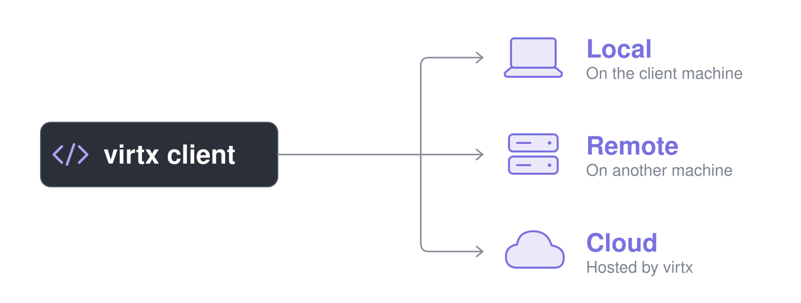
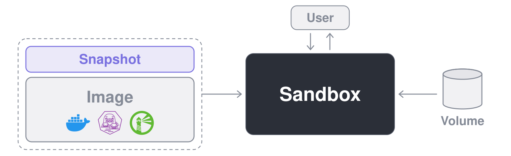

<p align="center">
  
  
</p>

<h3 align="center">코드와 AI 에이전트를 위한 일회용 Linux VM</h3>

<p align="center">
   <a href="https://pypi.org/project/virtx/"></a>
   <a href="https://www.npmjs.com/package/@brekkylab/virtx"></a>
   <a href="https://crates.io/crates/virtx"></a>
</p>

<p align="center">
  <a href="https://discord.gg/27rx3EJy3P"></a>
  <a href="https://x.com/brekkylab"></a>
</p>

<p align="center">
  <a href="README.md">English</a> · <a href="README.zh-CN.md">简体中文</a> · <a href="README.ja.md">日本語</a> · <b>한국어</b>
</p>

<br>

virtx를 쓰면 내 코드에서 일회용 Linux VM을 띄워 작업을 실행할 수 있습니다.

내 컴퓨터에 굳이 설치하고 싶지 않은 무거운 의존성이 필요한 작업이나, AI 에이전트가 스스로 판단해 실행하는 명령처럼 아예 내 컴퓨터에서 돌리고 싶지 않은 코드에 특히 유용합니다.
VM 안에서 설치하거나 바꾼 것은 VM을 지우면 모두 사라지고, 남겨 둔 스냅샷이나 볼륨에 기록한 것만 그대로 남습니다.

> [!TIP]
> virtx로 AI 에이전트를 만들고 있다면 저희가 만든 오픈소스 에이전트 SDK인 [Ailoy](https://github.com/brekkylab/ailoy)도 살펴보세요.
> virtx 위에서 만들어져 에이전트마다 전용 샌드박스를 붙여 주기 때문에, 따로 설정하지 않아도 에이전트의 명령과 파일 도구가 VM 안에서 실행됩니다.

## 빠르게 시작하기

> [!TIP]
> 코딩 에이전트를 쓰고 있다면 아래 명령으로 [virtx 스킬](skills/virtx/SKILL.md)을 설치하고, 이어지는 예제 코드는 에이전트에게 맡겨 보세요.
>
> ```bash
> claude plugin marketplace add brekkylab/virtx && claude plugin install virtx@brekkylab
> codex plugin marketplace add brekkylab/virtx && codex plugin add virtx@brekkylab
> ```

아래 예제는 모두 `jq`가 들어 있는 이미지를 빌드하고, 그 이미지로 샌드박스를 띄워 명령을 실행한 뒤 출력을 보여 줍니다.

### 로컬

`Client.spawn()`이 로컬 서버를 알아서 띄워 줍니다.

<details open>
<summary><b>Python</b></summary>

```sh
pip install virtx
```

```python
import asyncio

from virtx import Client, ImageJobEnd, Log, Recipe, SandboxJobEnd, Stderr, Stdout


async def main() -> None:
    with Client.spawn() as client:
        recipe = Recipe("alpine:latest").run("apk add --no-cache jq")
        async for entry in client.build_image(recipe, "jq:latest"):
            match entry.entry:
                case Log(line):
                    print(line)
                case ImageJobEnd(error=str(error)):
                    raise RuntimeError(error)

        sandbox = await client.create_sandbox("jq:latest")
        try:
            cmd = ["sh", "-c", """echo '{"hello": "virtx"}' | jq -r .hello"""]
            async for entry in sandbox.exec(cmd):
                match entry.entry:
                    case Stdout(line) | Stderr(line):
                        print(line)
                    case SandboxJobEnd(code):
                        print("exited", code)
        finally:
            await sandbox.remove()


asyncio.run(main())
```

</details>

<details>
<summary><b>Node</b></summary>

```sh
npm install @brekkylab/virtx
```

```js
const { Client, Recipe } = require('@brekkylab/virtx')

async function main() {
  const client = Client.spawn()
  try {
    const recipe = new Recipe('alpine:latest').run('apk add --no-cache jq')
    for await (const entry of client.buildImage(recipe, 'jq:latest')) {
      if ('log' in entry) console.log(entry.log)
      else if ('end' in entry && entry.end.error) throw new Error(entry.end.error)
    }

    const sandbox = await client.createSandbox('jq:latest')
    try {
      const cmd = ['sh', '-c', `echo '{"hello": "virtx"}' | jq -r .hello`]
      for await (const entry of sandbox.exec(cmd)) {
        if ('stdout' in entry) console.log(entry.stdout)
        else if ('stderr' in entry) console.error(entry.stderr)
        else if ('end' in entry) console.log('exited', entry.end.code)
      }
    } finally {
      await sandbox.remove()
    }
  } finally {
    await client.close()
  }
}

main()
```

</details>

<details>
<summary><b>Rust</b></summary>

```sh
cargo add virtx futures
cargo add tokio --features macros,rt-multi-thread
```

```rust
use futures::StreamExt;
use virtx::{
    Client, ImageJobEntry, Recipe, SandboxCreateArgs, SandboxExecArgs, SandboxJobEntry,
};

#[tokio::main]
async fn main() -> Result<(), Box<dyn std::error::Error>> {
    let client = Client::spawn_virtx([] as [&str; 0])?;

    let recipe = Recipe::new("alpine:latest").step("apk add --no-cache jq");
    let mut log = client.build_image(recipe, "jq:latest").log();
    while let Some(entry) = log.next().await {
        match entry?.entry {
            ImageJobEntry::Log(line) => println!("{line}"),
            ImageJobEntry::End(end) if end.error.is_some() => Err(end.error.unwrap())?,
            _ => {}
        }
    }

    let sandbox = client
        .create_sandbox(&SandboxCreateArgs::new("jq:latest"))
        .await?;
    let cmd = ["sh", "-c", r#"echo '{"hello": "virtx"}' | jq -r .hello"#];
    let mut log = sandbox.exec(&SandboxExecArgs::new(cmd)).log();
    while let Some(entry) = log.next().await {
        match entry?.entry {
            SandboxJobEntry::Stdout(line) | SandboxJobEntry::Stderr(line) => println!("{line}"),
            SandboxJobEntry::End(end) => println!("exited {}", end.code),
            _ => {}
        }
    }
    sandbox.remove().await?;
    Ok(())
}
```

</details>

### 원격

각 [릴리스](https://github.com/brekkylab/virtx/releases)에는 서버가 `virtx-server-tcp-<os>-<arch>.tar.gz`로 들어 있습니다(`macos-aarch64`, `linux-x86_64`, `linux-aarch64`, `windows-x86_64`). 안에는 `virtx-server-tcp`, 게스트 커널, `abin/`이 있습니다. 별도 디렉터리에 풀면 `virtx-server-tcp`가 옆에 있는 게스트 커널을 찾으므로, `PATH`나 라이브러리 경로를 설정하지 않고 그 자리에서 실행할 수 있습니다.

서버 머신에서 토큰을 만들고, 그 토큰을 가진 사용자가 프로젝트에 접근할 수 있도록 `server.json`을 작성합니다.

```sh
virtx-server-tcp token   # 토큰과 그 token_sha256을 출력합니다
```

```json
{
  "listen": "127.0.0.1:8470",
  "home": "/var/lib/virtx",
  "users": { "alice": { "token_sha256": "<token_sha256>" } },
  "projects": { "demo": { "members": ["alice"] } }
}
```

```sh
virtx-server-tcp serve --config server.json
```

클라이언트에서는 `Client.spawn()` 대신 토큰과 프로젝트를 지정해 접속합니다.
나머지는 로컬 예제와 같습니다.

<details open>
<summary><b>Python</b></summary>

```python
from virtx import BearerAuth, Client

client = Client.connect(
    "http://127.0.0.1:8470", BearerAuth("<token>"), {"virtx-project": "demo"}
)
```

</details>

<details>
<summary><b>Node</b></summary>

```js
const client = Client.connect(
  'http://127.0.0.1:8470',
  { type: 'bearer', token: '<token>' },
  { 'virtx-project': 'demo' }
)
```

</details>

<details>
<summary><b>Rust</b></summary>

```rust
let client = Client::connect(
    "http://127.0.0.1:8470",
    Auth::Bearer { token: "<token>".into() },
    [("virtx-project", "demo")],
)?;
```

</details>

클라이언트는 평문 `http`로는 자기 머신의 루프백 주소에만 토큰을 보내므로, 서버를 다른 머신에서 돌린다면 앞단에 HTTPS를 두세요.

## 주요 기능

- **신뢰할 수 없는 코드는 내 컴퓨터 밖에서:** 샌드박스는 모두 자체 커널을 가진 microVM이라 네임스페이스 수준이 아니라 하이퍼바이저 수준에서 격리되고, 네트워크도 완전히 끊을 수 있습니다.
- **어디서 작업하든 그대로:** 어떤 클라이언트든 어느 호스트의 어떤 서버와도 함께 쓸 수 있고, 로컬 서버에서 원격 서버나 클라우드로 옮길 때도 코드 한 줄만 바꾸면 됩니다.
  - **클라이언트:**  Python ·  Node ·  Rust
  - **서버:** 💻 로컬 (stdio) · 🖥️ 원격 (tcp) · ☁️ 클라우드
  - **호스트:**  Linux ·  macOS ·  Windows
- **설정은 최소한으로:** 패키지만 설치하면 바로 실행할 수 있고, Docker도 따로 띄워 둘 데몬도 필요 없습니다.
- **쓰던 이미지를 그대로:** Docker Hub나 어떤 OCI 레지스트리에서든 이미지를 받아 오거나 레시피 또는 Dockerfile로 빌드할 수 있고, 다시 푸시하거나 다른 서버로 복사할 수도 있습니다.
- **셸 없이 파일 주고받기:** 샌드박스 안의 파일을 코드에서 바로 읽고, 쓰고, 복사하고, 지울 수 있습니다.
- **안에서 돌아가는 서비스에 바로 접속:** 샌드박스 안의 웹 서버, SSH, VNC 데스크톱, 데이터베이스에 내 컴퓨터의 주소로 접속할 수 있습니다.
- **하던 작업 이어 가기:** 샌드박스가 쓴 내용을 스냅샷에 남겨 다음 샌드박스로 넘기고, 볼륨 하나를 여러 샌드박스가 함께 쓰고, Notion, Google Drive, OneDrive를 평범한 파일처럼 마운트할 수 있습니다.
- **GPU도 함께:** 샌드박스 안에서 호스트의 GPU로 딥러닝을 비롯한 Vulkan 작업을 돌릴 수 있습니다.

## 요구 사항

### 클라이언트

쓰는 언어에 맞춰 확인하세요.

- **Python:** 3.11 이상
- **Node:** 22 이상
- **Rust:** 1.89 이상

### 서버

virtx 서버를 실행하는 머신에 필요한 조건입니다.
게스트는 항상 Linux입니다.

#### 하이퍼바이저

- **Linux**: KVM을 지원하는 커널, 내 사용자 계정으로 접근할 수 있는 `/dev/kvm`, 펌웨어에서 켜 둔 하드웨어 가상화가 필요합니다.
  KVM은 요즘 커널 대부분에 기본으로 들어 있어서 보통은 따로 설치할 것이 없습니다.
- **macOS**: Apple 실리콘만 지원합니다.
  VM은 OS에 내장된 `Hypervisor.framework` 위에서 돌아가므로 따로 설치하거나 켤 것이 없습니다.
- **Windows**: Windows 11 이상, x86_64만 지원합니다.
  VM은 Windows 하이퍼바이저 플랫폼(Windows Hypervisor Platform) 위에서 돌아갑니다.
  이 기능이 꺼져 있다면 관리자 권한 PowerShell에서 아래 명령을 실행한 뒤 재부팅하세요.

  ```powershell
  Enable-WindowsOptionalFeature -Online -FeatureName HypervisorPlatform
  ```

#### GPU (선택)

GPU를 쓰는 샌드박스에만 필요합니다.
호스트에는 Vulkan 로더가, 이미지에는 게스트 쪽 Vulkan 구성 요소가 있어야 합니다.
자세한 내용은 [GPU 사용하기](docs/content/guides/using-gpus.mdx)를 참고하세요.

## 동작 방식

### 클라이언트-서버 구조

virtx는 클라이언트-서버 구조로 동작합니다.
클라이언트인 내 코드가 virtx 서버에 무엇을 실행할지 알려 주면, 서버가 그것을 VM에서 실행하고 결과를 돌려줍니다.

<p align="center">
  
</p>

서버는 내 코드와 같은 머신이나 다른 머신에서 직접 운영할 수도 있고, 대신 호스팅해 주는 virtx cloud를 쓸 수도 있습니다.
어느 쪽이든 클라이언트와 서버는 같은 HTTP 프로토콜로 통신하며, 달라지는 것은 전송 방식뿐입니다.

| | 로컬 | 원격 | 클라우드 |
| --- | --- | --- | --- |
| 서버 | `virtx-stdio` | `virtx-server-tcp` | virtx cloud |
| 실행 위치 | 클라이언트 프로세스의 자식 프로세스 | 클라이언트와 떨어진 다른 머신의 데몬 | virtx가 대신 운영하는 머신 |
| 전송 방식 | stdio를 통한 HTTP | TCP를 통한 HTTP | HTTPS |
| 준비할 것 | 설치할 것도, 계속 띄워 둘 것도 없음 | 서버를 띄우고 사용자마다 토큰 발급 | 로그인 후 API 키 생성 |
| 이럴 때 | 지금 작업하는 머신에서 VM을 돌릴 때 | 더 큰 머신이 필요하거나 팀이 호스트 하나를 함께 쓸 때 | 내 하드웨어 없이 VM을 돌릴 때 |

각 VM은 libkrun 기반 microVM으로, 호스트의 하드웨어 가상화(Linux는 KVM, macOS는 Hypervisor.framework, Windows는 Windows 하이퍼바이저 플랫폼) 위에서 자체 커널로 돌아가는 Linux 게스트입니다.
그 안의 코드는 컨테이너처럼 네임스페이스로만 나뉘는 것이 아니라 하이퍼바이저로 내 컴퓨터와 분리됩니다.
게다가 microVM은 띄워야 할 펌웨어나 에뮬레이션 하드웨어가 없어서, 일반 VM에 비해 훨씬 짧은 시간 안에 부팅됩니다.

### 핵심 개념

가장 중심이 되는 리소스는 명령을 실행하는 VM인 **샌드박스**입니다.

<p align="center">
  
</p>

샌드박스의 루트 파일시스템은 두 층을 겹친 오버레이입니다.
아래층은 읽기 전용인 **이미지**, 위층은 쓰기 내용이 기록되는 **스냅샷**입니다.

이미지는 그 위에서 만든 모든 샌드박스의 출발점입니다.
Docker가 쓰는 것과 같은 OCI 이미지 형식이라서, `alpine:latest`를 비롯해 레지스트리에 있는 이미지라면 무엇이든 쓸 수 있습니다.

스냅샷에는 샌드박스가 바꾼 내용이 차곡차곡 쌓입니다.
새 스냅샷은 빈 상태로 시작하고, 나중에 그 스냅샷으로 만든 샌드박스는 직전 샌드박스가 쓴 내용을 모두 가진 채 시작합니다.
그래서 앞 샌드박스가 설치한 것을 다음 샌드박스에서 그대로 쓸 수 있습니다.
스냅샷 하나는 한 번에 샌드박스 하나만 쓸 수 있습니다.
스냅샷 없이 만든 샌드박스에는 전용 스냅샷이 따로 생기고, 이 스냅샷은 샌드박스를 지울 때 함께 사라집니다.

루트 파일시스템과 별개로 저장 공간이 필요하다면 **볼륨**을 쓰세요.
볼륨은 스냅샷과 달리 특정 경로에 읽기-쓰기 또는 읽기 전용으로 마운트하며, 여러 샌드박스에 동시에 마운트할 수도 있습니다.
샌드박스를 지워도 볼륨은 남아 있고, 볼륨의 파일은 샌드박스 없이도 코드에서 바로 읽고 쓸 수 있습니다.
Notion, Google Drive, OneDrive 같은 원격 저장소도 볼륨 안에 읽기 전용으로 마운트할 수 있어서, 샌드박스에서는 이것들이 그냥 파일로 보입니다.

## 문서

가이드와 API 레퍼런스는 [문서](docs/)에서 볼 수 있습니다.
그 밖의 API는 패키지별 문서에 정리되어 있습니다: [Python](virtx-py/README.md), [Node](virtx-node/README.md), [Rust](https://docs.rs/virtx).

## 소스에서 빌드하기

AGENTS.md의 [Building from source](AGENTS.md#building-from-source)를 참고하세요.

## 기여하기

버그 제보, 아이디어, 풀 리퀘스트 모두 환영합니다.
PR을 올리는 방법은 [CONTRIBUTING.md](CONTRIBUTING.md)에 정리되어 있습니다.
보안 취약점으로 보이는 것을 발견했다면 공개 이슈를 열지 말고 [SECURITY.md](SECURITY.md)의 절차를 따라 주세요.
질문이나 만든 것 자랑은 [Discord](https://discord.gg/27rx3EJy3P)에서 나눠 주세요.

## 라이선스

Apache-2.0 라이선스를 따릅니다. 자세한 내용은 [LICENSE](LICENSE)를 참고하세요.
