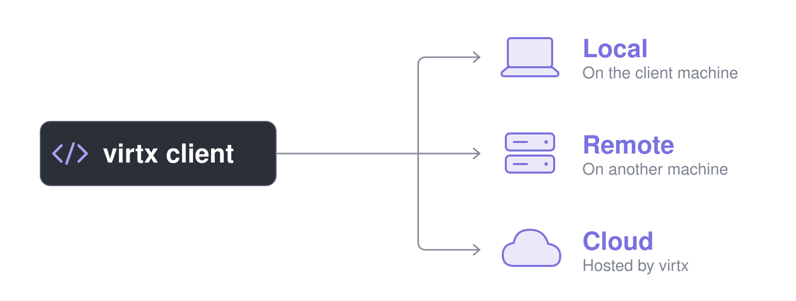
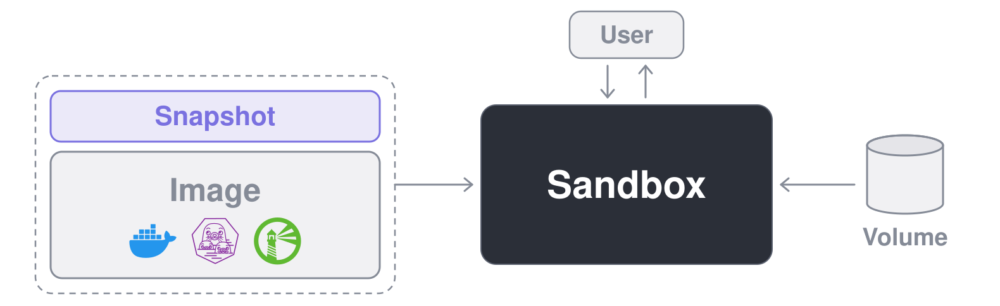

<p align="center">
  
  
</p>

<h3 align="center">Disposable Linux VMs for your code and your AI agents.</h3>

<p align="center">
   <a href="https://pypi.org/project/virtx/"></a>
   <a href="https://www.npmjs.com/package/@brekkylab/virtx"></a>
   <a href="https://crates.io/crates/virtx"></a>
</p>

<p align="center">
  <a href="https://discord.gg/27rx3EJy3P"></a>
  <a href="https://x.com/brekkylab"></a>
</p>

<p align="center">
  <b>English</b> · <a href="README.zh-CN.md">简体中文</a> · <a href="README.ja.md">日本語</a> · <a href="README.ko.md">한국어</a>
</p>

<br>

virtx lets you run tasks in disposable Linux VMs from your own code.

It's useful for jobs with heavy dependencies that you'd rather not install on your own machine, and for code you'd rather not run on it at all, such as the commands an AI agent decides to run.
Whatever a VM installs or changes is gone when you remove it, unless it wrote it to a snapshot or a volume you kept.

> [!TIP]
> Building an AI agent on virtx? [Ailoy](https://github.com/brekkylab/ailoy), our open-source agent SDK, is built on it and gives every agent a sandbox of its own, so its commands and file tools run in a VM with no setup.

## Quickstart

> [!TIP]
> Using a coding agent? Install the [virtx skill](skills/virtx/SKILL.md) and let it write this for you:
>
> ```bash
> claude plugin marketplace add brekkylab/virtx && claude plugin install virtx@brekkylab
> codex plugin marketplace add brekkylab/virtx && codex plugin add virtx@brekkylab
> ```

Each example builds an image with `jq` in it, boots a sandbox from it, runs a command, and prints its output.

### Local

`Client.spawn()` starts a local server for you.

<details open>
<summary><b>Python</b></summary>

```sh
pip install virtx
```

```python
import asyncio

from virtx import Client, Recipe


async def main() -> None:
    with Client.spawn() as client:
        recipe = Recipe("alpine:latest").run("apk add --no-cache jq")
        await client.build_image(recipe, "jq:latest").complete(print=True)

        sandbox = await client.create_sandbox("jq:latest")
        try:
            cmd = ["sh", "-c", """echo '{"hello": "virtx"}' | jq -r .hello"""]
            code = await sandbox.exec(cmd).complete(print=True)
            print("exited", code)
        finally:
            await sandbox.remove()


asyncio.run(main())
```

</details>

<details>
<summary><b>Node</b></summary>

```sh
npm install @brekkylab/virtx
```

```js
const { Client, Recipe } = require('@brekkylab/virtx')

async function main() {
  const client = Client.spawn()
  try {
    const recipe = new Recipe('alpine:latest').run('apk add --no-cache jq')
    await client.buildImage(recipe, 'jq:latest').complete({ print: true })

    const sandbox = await client.createSandbox('jq:latest')
    try {
      const cmd = ['sh', '-c', `echo '{"hello": "virtx"}' | jq -r .hello`]
      const code = await sandbox.exec(cmd).complete({ print: true })
      console.log('exited', code)
    } finally {
      await sandbox.remove()
    }
  } finally {
    await client.close()
  }
}

main()
```

</details>

<details>
<summary><b>Rust</b></summary>

```sh
cargo add virtx
cargo add tokio --features macros,rt-multi-thread
```

```rust
use virtx::{Client, Recipe, SandboxCreateArgs, SandboxExecArgs};

#[tokio::main]
async fn main() -> Result<(), Box<dyn std::error::Error>> {
    let client = Client::spawn_virtx([] as [&str; 0])?;

    let recipe = Recipe::new("alpine:latest").step("apk add --no-cache jq");
    client.build_image(recipe, "jq:latest").complete(true).await?;

    let sandbox = client
        .create_sandbox(&SandboxCreateArgs::new("jq:latest"))
        .await?;
    let cmd = ["sh", "-c", r#"echo '{"hello": "virtx"}' | jq -r .hello"#];
    let code = sandbox.exec(&SandboxExecArgs::new(cmd)).complete(true).await?;
    println!("exited {code}");
    sandbox.remove().await?;
    Ok(())
}
```

</details>

### Remote

On the server machine, make a token and write a `server.json` that lets its user into a project:

```sh
virtx-server-tcp token   # prints a token and its token_sha256
```

```json
{
  "listen": "127.0.0.1:8470",
  "home": "/var/lib/virtx",
  "users": { "alice": { "token_sha256": "<token_sha256>" } },
  "projects": { "demo": { "members": ["alice"] } }
}
```

```sh
virtx-server-tcp serve --config server.json
```

On the client, connect with the token and the project in place of `Client.spawn()`.
The rest is the same as the local example.

<details open>
<summary><b>Python</b></summary>

```python
from virtx import BearerAuth, Client

client = Client.connect(
    "http://127.0.0.1:8470", BearerAuth("<token>"), {"virtx-project": "demo"}
)
```

</details>

<details>
<summary><b>Node</b></summary>

```js
const client = Client.connect(
  'http://127.0.0.1:8470',
  { type: 'bearer', token: '<token>' },
  { 'virtx-project': 'demo' }
)
```

</details>

<details>
<summary><b>Rust</b></summary>

```rust
let client = Client::connect(
    "http://127.0.0.1:8470",
    Auth::Bearer { token: "<token>".into() },
    [("virtx-project", "demo")],
)?;
```

</details>

A client sends a token over plain `http` only to this machine's loopback, so put a server on another machine behind HTTPS.

## Features

- **Keep untrusted code off your machine:** every sandbox is a microVM with its own kernel, walled off by the hypervisor, not just by namespaces, and its network can be cut entirely.
- **Run it wherever you work:** any client works with any server on any host, and moving from a local server to a remote one or the cloud changes one line.
  - **Clients:**  Python ·  Node ·  Rust
  - **Servers:** 💻 local (stdio) · 🖥️ remote (tcp) · ☁️ cloud
  - **Hosts:**  Linux ·  macOS ·  Windows
- **Minimal setup:** install the package and you are ready to run, with no Docker and no daemon to set up.
- **Start from any image you already use:** pull from Docker Hub or any OCI registry, or build from a recipe or a Dockerfile, then push it back or copy it to another server.
- **Move files in and out without a shell:** read, write, copy and remove a sandbox's files straight from your code.
- **Reach anything running inside:** a web server, SSH, a VNC desktop or a database in the sandbox, at an address on your machine.
- **Pick up where you left off:** keep what a sandbox wrote in a snapshot for the next one, share a volume among sandboxes, and mount Notion, Google Drive or OneDrive as plain files.
- **Bring the GPU along:** run deep learning and other Vulkan work on the host's GPU from inside the sandbox.

## Requirements

### Client

Pick the one for the language you use.

- **Python:** 3.10 or later.
- **Node:** 18 or later.
- **Rust:** 1.89 or later.

### Server

These apply to the machine that runs the virtx server.
Guests are always Linux.

#### Hypervisor

- **Linux**: a kernel with KVM support, `/dev/kvm` accessible to your user, and hardware virtualization enabled in the firmware.
  KVM is built into most modern kernels, so nothing usually needs installing.
- **macOS**: Apple silicon only.
  The VM runs on `Hypervisor.framework`, which is built in, so nothing needs installing or turning on.
- **Windows**: Windows 11 or later, x86_64 only.
  The VM runs on the Windows Hypervisor Platform.
  If it is off, run this in an administrator PowerShell and restart:

  ```powershell
  Enable-WindowsOptionalFeature -Online -FeatureName HypervisorPlatform
  ```

#### (Optional) GPU

Only for sandboxes that use the GPU: a Vulkan loader on the host, plus the guest's half of Vulkan in the image. See [Using GPUs](docs/content/guides/using-gpus.mdx).

## How it works

### Client-server model

virtx follows a client-server model.
Your code, the client, tells a virtx server what to run, and the server runs it in a VM and sends the results back.

<p align="center">
  
</p>

The server can be one you run yourself, on the same machine as your code or on another one, or virtx cloud, hosted for you.
Either way, client and server speak the same plain HTTP protocol; only the transport differs.

| | Local | Remote | Cloud |
| --- | --- | --- | --- |
| Server | `virtx-stdio` | `virtx-server-tcp` | virtx cloud |
| Where it runs | Child process of client process | Daemon on another machine, separate from the client | virtx's own machines, hosted for you |
| Transport | HTTP over stdio | HTTP over TCP | HTTPS |
| Setup | None: nothing to install or keep running | Run the server, and give each user a token | Sign in and create an API key |
| Use it for | Running VMs on the machine you work on | A bigger machine, or one host shared by a team | Running VMs without hardware of your own |

Each VM is a libkrun-based microVM: a Linux guest with its own kernel, on the host's hardware virtualization (KVM on Linux, Hypervisor.framework on macOS, the Windows Hypervisor Platform on Windows).
Code in it is separated from your machine by a hypervisor, not just by namespaces as in a container, and a microVM boots in a fraction of the time a full VM takes, since there is no firmware or emulated hardware to bring up.

### Core concepts

The main resource is the **sandbox**: a VM you run commands in.

<p align="center">
  
</p>

A sandbox's root filesystem is an overlay of two layers: an **image** below, read-only, and a **snapshot** above, where its writes go.

The image is what every sandbox on it starts from.
Images are OCI images, the format Docker uses, so `alpine:latest` or any image from a registry works.

The snapshot is where a sandbox's changes pile up.
A new snapshot starts empty; a sandbox made on it later starts with everything the last one wrote, so what one installed the next one finds.
One sandbox holds a snapshot at a time.
A sandbox made without a snapshot has its own, which goes when the sandbox is removed.

When a sandbox needs storage apart from its root filesystem, use a **volume**.
Unlike a snapshot, a volume is mounted at a path, read-write or read-only, and can be mounted into several sandboxes at once.
It stays when they are removed, and its files can be read and written from your code without a sandbox at all.
Remote stores such as Notion, Google Drive and OneDrive can be mounted inside a volume too, read-only, so a sandbox sees them as files.

## Documentation

See the [documentation](docs/) for guides and the API reference.
Each package documents the rest of its API: [Python](virtx-py/README.md), [Node](virtx-node/README.md), [Rust](https://docs.rs/virtx).

## Building from source

See [Building from source](AGENTS.md#building-from-source) in AGENTS.md.

## Contributing

Bug reports, ideas and pull requests are welcome.
[CONTRIBUTING.md](CONTRIBUTING.md) covers how to open a PR.
For a suspected vulnerability, please follow [SECURITY.md](SECURITY.md) instead of opening a public issue.
Questions and show-and-tell go on [Discord](https://discord.gg/27rx3EJy3P).

## License

Apache-2.0. See [LICENSE](LICENSE).
