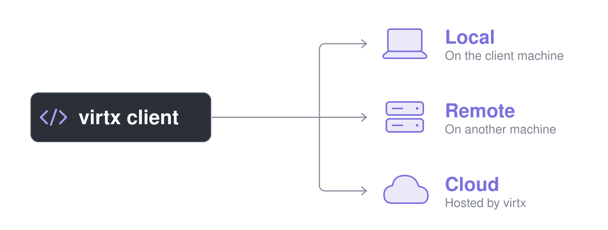
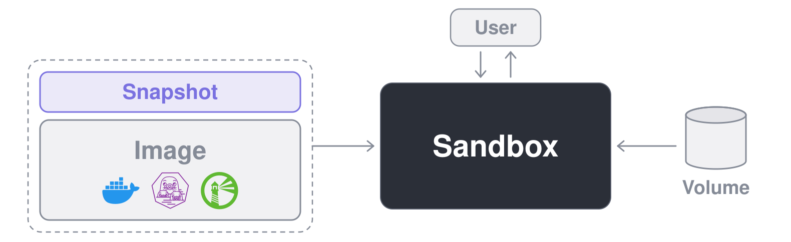

<p align="center">
  
  
</p>

<h3 align="center">供代码和 AI 智能体使用的一次性 Linux 虚拟机</h3>

<p align="center">
   <a href="https://pypi.org/project/virtx/"></a>
   <a href="https://www.npmjs.com/package/@brekkylab/virtx"></a>
   <a href="https://crates.io/crates/virtx"></a>
</p>

<p align="center">
  <a href="https://discord.gg/27rx3EJy3P"></a>
  <a href="https://x.com/brekkylab"></a>
</p>

<p align="center">
  <a href="README.md">English</a> · <b>简体中文</b> · <a href="README.ja.md">日本語</a> · <a href="README.ko.md">한국어</a>
</p>

<br>

有了 virtx，你可以直接在自己的代码里启动一次性的 Linux 虚拟机来运行任务。

有些任务需要装一大堆依赖，你不想把它们装在本机上；有些代码你干脆不想在本机跑，比如 AI 智能体自己决定要执行的命令。
这些都很适合交给 virtx。
虚拟机里装过、改过的东西，在删除虚拟机后都会一并清掉，只有写进你保留下来的快照或卷里的内容才会留下。

> [!TIP]
> 正在用 virtx 开发 AI 智能体？不妨看看我们的开源智能体 SDK [Ailoy](https://github.com/brekkylab/ailoy)。
> 它基于 virtx 构建，会给每个智能体分配一个专属沙箱，不用做任何配置，智能体的命令和文件工具就会在虚拟机里运行。

## 快速上手

> [!TIP]
> 在用编程智能体？装上 [virtx skill](skills/virtx/SKILL.md)，后面的示例代码就可以交给它来写。安装命令如下：
>
> ```bash
> claude plugin marketplace add brekkylab/virtx && claude plugin install virtx@brekkylab
> codex plugin marketplace add brekkylab/virtx && codex plugin add virtx@brekkylab
> ```

下面的每个示例都会构建一个装有 `jq` 的镜像，用它启动一个沙箱，执行一条命令，再把输出打印出来。

### 本地

`Client.spawn()` 会自动帮你启动一个本地服务器。

<details open>
<summary><b>Python</b></summary>

```sh
pip install virtx
```

```python
import asyncio

from virtx import Client, ImageJobEnd, Log, Recipe, SandboxJobEnd, Stderr, Stdout


async def main() -> None:
    with Client.spawn() as client:
        recipe = Recipe("alpine:latest").run("apk add --no-cache jq")
        async for entry in client.build_image(recipe, "jq:latest"):
            match entry.entry:
                case Log(line):
                    print(line)
                case ImageJobEnd(error=str(error)):
                    raise RuntimeError(error)

        sandbox = await client.create_sandbox("jq:latest")
        try:
            cmd = ["sh", "-c", """echo '{"hello": "virtx"}' | jq -r .hello"""]
            async for entry in sandbox.exec(cmd):
                match entry.entry:
                    case Stdout(line) | Stderr(line):
                        print(line)
                    case SandboxJobEnd(code):
                        print("exited", code)
        finally:
            await sandbox.remove()


asyncio.run(main())
```

</details>

<details>
<summary><b>Node</b></summary>

```sh
npm install @brekkylab/virtx
```

```js
const { Client, Recipe } = require('@brekkylab/virtx')

async function main() {
  const client = Client.spawn()
  try {
    const recipe = new Recipe('alpine:latest').run('apk add --no-cache jq')
    for await (const entry of client.buildImage(recipe, 'jq:latest')) {
      if ('log' in entry) console.log(entry.log)
      else if ('end' in entry && entry.end.error) throw new Error(entry.end.error)
    }

    const sandbox = await client.createSandbox('jq:latest')
    try {
      const cmd = ['sh', '-c', `echo '{"hello": "virtx"}' | jq -r .hello`]
      for await (const entry of sandbox.exec(cmd)) {
        if ('stdout' in entry) console.log(entry.stdout)
        else if ('stderr' in entry) console.error(entry.stderr)
        else if ('end' in entry) console.log('exited', entry.end.code)
      }
    } finally {
      await sandbox.remove()
    }
  } finally {
    await client.close()
  }
}

main()
```

</details>

<details>
<summary><b>Rust</b></summary>

```sh
cargo add virtx futures
cargo add tokio --features macros,rt-multi-thread
```

```rust
use futures::StreamExt;
use virtx::{
    Client, ImageJobEntry, Recipe, SandboxCreateArgs, SandboxExecArgs, SandboxJobEntry,
};

#[tokio::main]
async fn main() -> Result<(), Box<dyn std::error::Error>> {
    let client = Client::spawn_virtx([] as [&str; 0])?;

    let recipe = Recipe::new("alpine:latest").step("apk add --no-cache jq");
    let mut log = client.build_image(recipe, "jq:latest").log();
    while let Some(entry) = log.next().await {
        match entry?.entry {
            ImageJobEntry::Log(line) => println!("{line}"),
            ImageJobEntry::End(end) if end.error.is_some() => Err(end.error.unwrap())?,
            _ => {}
        }
    }

    let sandbox = client
        .create_sandbox(&SandboxCreateArgs::new("jq:latest"))
        .await?;
    let cmd = ["sh", "-c", r#"echo '{"hello": "virtx"}' | jq -r .hello"#];
    let mut log = sandbox.exec(&SandboxExecArgs::new(cmd)).log();
    while let Some(entry) = log.next().await {
        match entry?.entry {
            SandboxJobEntry::Stdout(line) | SandboxJobEntry::Stderr(line) => println!("{line}"),
            SandboxJobEntry::End(end) => println!("exited {}", end.code),
            _ => {}
        }
    }
    sandbox.remove().await?;
    Ok(())
}
```

</details>

### 远程

在服务器上生成一个令牌，再写一份 `server.json`，允许该令牌对应的用户访问某个项目：

```sh
virtx-server-tcp token   # 打印令牌及其 token_sha256
```

```json
{
  "listen": "127.0.0.1:8470",
  "home": "/var/lib/virtx",
  "users": { "alice": { "token_sha256": "<token_sha256>" } },
  "projects": { "demo": { "members": ["alice"] } }
}
```

```sh
virtx-server-tcp serve --config server.json
```

在客户端，不再调用 `Client.spawn()`，而是带上令牌和项目名去连接。
其余部分和本地示例完全一样。

<details open>
<summary><b>Python</b></summary>

```python
from virtx import BearerAuth, Client

client = Client.connect(
    "http://127.0.0.1:8470", BearerAuth("<token>"), {"virtx-project": "demo"}
)
```

</details>

<details>
<summary><b>Node</b></summary>

```js
const client = Client.connect(
  'http://127.0.0.1:8470',
  { type: 'bearer', token: '<token>' },
  { 'virtx-project': 'demo' }
)
```

</details>

<details>
<summary><b>Rust</b></summary>

```rust
let client = Client::connect(
    "http://127.0.0.1:8470",
    Auth::Bearer { token: "<token>".into() },
    [("virtx-project", "demo")],
)?;
```

</details>

客户端只有在目标是本机回环地址时，才会通过明文 `http` 发送令牌，所以部署在其他机器上的服务器，请在前面加一层 HTTPS。

## 功能亮点

- **在隔离环境中运行不可信代码：** 每个沙箱都是拥有独立内核的 microVM，由 Hypervisor 提供隔离，而不只是靠命名空间，需要时还能完全断开网络。
- **在哪儿开发都能用：** 任何客户端都能对接任何主机上的任何服务器，从本地服务器切到远程服务器或云端，只需改一行代码。
  - **客户端：**  Python ·  Node ·  Rust
  - **服务器：** 💻 本地 (stdio) · 🖥️ 远程 (tcp) · ☁️ 云端
  - **主机：**  Linux ·  macOS ·  Windows
- **几乎不用配置：** 装好包就能直接跑，不需要 Docker，也无需单独配置守护进程。
- **现有镜像拿来就用：** 可以从 Docker Hub 或任意 OCI 镜像仓库拉取，也可以用 recipe 或 Dockerfile 构建，之后还能推回仓库或复制到另一台服务器。
- **不开 shell 也能传文件：** 直接在代码里读写、复制和删除沙箱中的文件。
- **沙箱里跑的服务都能访问：** 沙箱里的 Web 服务器、SSH、VNC 桌面或数据库，都可以通过本机上的地址直接访问。
- **从上次中断的地方继续：** 把沙箱写下的内容存进快照留给下一个沙箱，让多个沙箱共享一个卷，还能把 Notion、Google Drive、OneDrive 当作普通文件挂载进来。
- **同样能用 GPU：** 在沙箱里用宿主机的 GPU 跑深度学习等 Vulkan 任务。

## 环境要求

### 客户端

按你使用的语言对照即可。

- **Python：** 3.11 及以上
- **Node：** 22 及以上
- **Rust：** 1.89 及以上

### 服务器

以下要求针对运行 virtx 服务器的机器。
客户机（guest）始终是 Linux。

#### Hypervisor

- **Linux**：内核需支持 KVM，当前用户要能访问 `/dev/kvm`，并且已在固件里开启硬件虚拟化。
  主流的新内核基本都内置了 KVM，通常不需要额外安装。
- **macOS**：仅支持 Apple 芯片。
  虚拟机运行在系统自带的 `Hypervisor.framework` 上，不需要安装或开启任何东西。
- **Windows**：Windows 11 及以上，仅支持 x86_64。
  虚拟机运行在 Windows 虚拟机监控程序平台（Windows Hypervisor Platform）上。
  如果它没有开启，请在管理员 PowerShell 中执行下面的命令，然后重启：

  ```powershell
  Enable-WindowsOptionalFeature -Online -FeatureName HypervisorPlatform
  ```

#### GPU（可选）

只有用到 GPU 的沙箱才需要。
宿主机上要装好 Vulkan 加载器，镜像里要带上客户机这一侧的 Vulkan 组件。
详见[使用 GPU](docs/content/guides/using-gpus.mdx)。

## 工作原理

### 客户端-服务器模型

virtx 采用客户端-服务器模型。
你的代码作为客户端，告诉 virtx 服务器要运行什么；服务器在虚拟机里把它跑起来，再把结果传回来。

<p align="center">
  
</p>

服务器可以由你自己运行，和代码放在同一台机器上，或者放在另一台机器上；也可以直接用我们托管的 virtx cloud。
无论采用哪种方式，客户端和服务器都使用同一套 HTTP 协议通信，区别只在传输方式。

| | 本地 | 远程 | 云端 |
| --- | --- | --- | --- |
| 服务器 | `virtx-stdio` | `virtx-server-tcp` | virtx cloud |
| 运行位置 | 客户端进程的子进程 | 另一台机器上的守护进程，与客户端分开 | virtx 自己的机器，由我们托管 |
| 传输方式 | 基于 stdio 的 HTTP | 基于 TCP 的 HTTP | HTTPS |
| 准备工作 | 无：不用安装，也不用一直开着 | 启动服务器，给每个用户发一个令牌 | 登录并创建 API 密钥 |
| 适用场景 | 在你正在用的机器上跑虚拟机 | 需要更强的机器，或团队共用一台主机 | 没有自己的硬件也能跑虚拟机 |

每个虚拟机都是基于 libkrun 的 microVM：一个拥有独立内核的 Linux 客户机，运行在宿主机的硬件虚拟化之上（Linux 上是 KVM，macOS 上是 Hypervisor.framework，Windows 上是 Windows 虚拟机监控程序平台）。
里面的代码和你的机器之间隔着一层 Hypervisor，而不像容器那样只靠命名空间隔开。
而且 microVM 没有固件和模拟硬件需要初始化，启动速度比完整虚拟机快得多。

### 核心概念

最核心的资源是**沙箱**，也就是用来执行命令的虚拟机。

<p align="center">
  
</p>

沙箱的根文件系统由两层叠加而成。
下层是只读的**镜像**，上层是接收写入的**快照**。

镜像是基于它创建的所有沙箱的起点。
镜像采用 OCI 格式，与 Docker 使用的格式相同，所以 `alpine:latest` 或者镜像仓库里的任何镜像都能直接用。

快照用来积累沙箱做出的改动。
新快照一开始是空的；之后用它创建的沙箱，会带着上一个沙箱写下的全部内容启动。
也就是说，上一个沙箱装好的东西，下一个沙箱直接就有。
同一时间，一个快照只能给一个沙箱用。
创建沙箱时如果没有指定快照，它会自带一个专属快照，沙箱删除时这个快照也随之删除。

如果沙箱需要根文件系统以外的存储空间，就用**卷**。
和快照不同，卷是挂载到某个路径上的，可以读写，也可以只读，还能同时挂载到多个沙箱。
沙箱删除后卷依然保留，而且不需要沙箱，也能直接在代码里读写卷中的文件。
Notion、Google Drive、OneDrive 这类远程存储也可以以只读方式挂载到卷里，在沙箱看来它们就是普通文件。

## 文档

指南和 API 参考请查看[文档](docs/)。
其余 API 分别写在各个包的文档里：[Python](virtx-py/README.md)、[Node](virtx-node/README.md)、[Rust](https://docs.rs/virtx)。

## 从源码构建

参见 AGENTS.md 中的 [Building from source](AGENTS.md#building-from-source)。

## 参与贡献

欢迎提交 bug 报告、分享想法或发起 Pull Request。
如何提交 PR，请看 [CONTRIBUTING.md](CONTRIBUTING.md)。
如果发现疑似安全漏洞，请按 [SECURITY.md](SECURITY.md) 的流程报告，不要公开提 issue。
有问题想问，或者想展示你做的东西，欢迎来 [Discord](https://discord.gg/27rx3EJy3P)。

## 许可证

Apache-2.0，详见 [LICENSE](LICENSE)。
