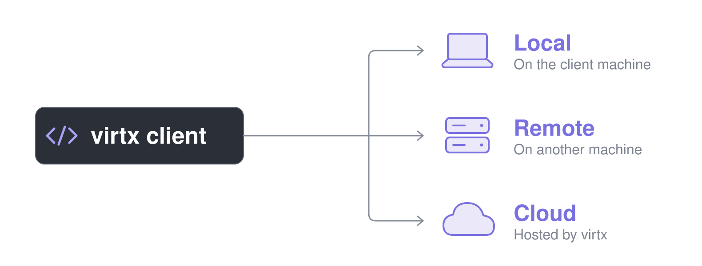
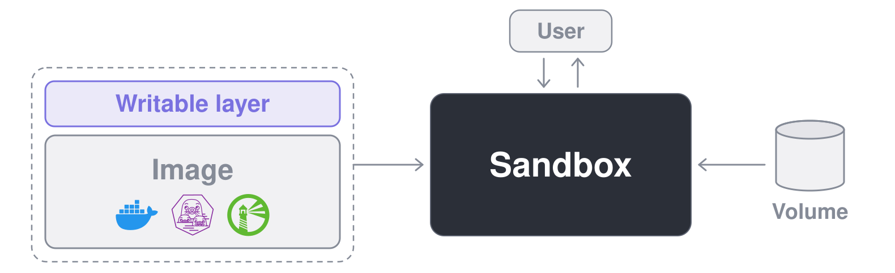

<p align="center">
  <picture>
    <source media="(prefers-color-scheme: dark)" srcset="https://raw.githubusercontent.com/brekkylab/virtx/main/assets/virtx-logo-signature-white.svg">
    
  </picture>
</p>

<h3 align="center">為你的程式碼與 AI 代理準備的拋棄式 Linux 虛擬機器</h3>

<p align="center">
   <a href="https://pypi.org/project/virtx/"></a>
   <a href="https://www.npmjs.com/package/@brekkylab/virtx"></a>
   <a href="https://crates.io/crates/virtx"></a>
</p>

<p align="center">
  <a href="https://virtx.sh/docs"></a>
  <a href="https://discord.gg/27rx3EJy3P"></a>
  <a href="https://x.com/brekkylab"></a>
</p>

<p align="center">
  <a href="README.md">English</a> · <a href="README.zh-Hans.md">简体中文</a> · <b>繁體中文</b> · <a href="README.ja.md">日本語</a> · <a href="README.ko.md">한국어</a>
</p>

<br>

virtx 讓你直接在自己的程式碼裡，用拋棄式的 Linux 虛擬機器執行任務。

有些工作需要一大堆相依套件，你不想裝在自己的電腦上；有些程式碼你根本不想在自己的電腦上執行，例如 AI 代理自行決定要跑的指令。
這些都很適合交給 virtx。
虛擬機器裡安裝或修改過的東西，在移除它之後都會消失，只有寫進你保留下來的磁碟區的內容才會留下。

> [!TIP]
> 正在用 virtx 打造 AI 代理嗎？我們的開源代理 SDK [Ailoy](https://github.com/brekkylab/ailoy) 就是以 virtx 為基礎，會替每個代理配一個專屬沙箱，不需任何設定，代理的指令和檔案工具就會在虛擬機器裡執行。

## 快速入門

> [!TIP]
> 有在用程式開發代理（coding agent）嗎？安裝 [virtx skill](skills/virtx/SKILL.md)，接下來的程式碼就能交給它來寫：
>
> ```bash
> claude plugin marketplace add brekkylab/virtx && claude plugin install virtx@brekkylab
> codex plugin marketplace add brekkylab/virtx && codex plugin add virtx@brekkylab
> ```

每個範例都會建置一個裝有 `jq` 的映像檔，用它啟動沙箱、執行一條指令，再印出輸出結果。

### 本機

`Client.spawn()` 會自動替你啟動一個本機伺服器。

<details open>
<summary><b>Python</b></summary>

```sh
pip install virtx
```

```python
import asyncio

from virtx import Client, Recipe


async def main() -> None:
    with Client.spawn() as client:
        recipe = Recipe("alpine:latest").run("apk add --no-cache jq")
        await client.build_image(recipe, "jq:latest").complete(print=True)

        sandbox = await client.create_sandbox("jq:latest")
        try:
            cmd = ["sh", "-c", """echo '{"hello": "virtx"}' | jq -r .hello"""]
            code = await sandbox.exec(cmd).complete(print=True)
            print("exited", code)
        finally:
            await sandbox.remove()


asyncio.run(main())
```

</details>

<details>
<summary><b>Node</b></summary>

```sh
npm install @brekkylab/virtx
```

```js
const { Client, Recipe } = require('@brekkylab/virtx')

async function main() {
  const client = Client.spawn()
  try {
    const recipe = new Recipe('alpine:latest').run('apk add --no-cache jq')
    await client.buildImage(recipe, 'jq:latest').complete({ print: true })

    const sandbox = await client.createSandbox('jq:latest')
    try {
      const cmd = ['sh', '-c', `echo '{"hello": "virtx"}' | jq -r .hello`]
      const code = await sandbox.exec(cmd).complete({ print: true })
      console.log('exited', code)
    } finally {
      await sandbox.remove()
    }
  } finally {
    await client.close()
  }
}

main()
```

</details>

<details>
<summary><b>Rust</b></summary>

```sh
cargo add virtx
cargo add tokio --features macros,rt-multi-thread
```

```rust
use virtx::{Client, Recipe, SandboxCreateArgs, SandboxExecArgs};

#[tokio::main]
async fn main() -> Result<(), Box<dyn std::error::Error>> {
    let client = Client::spawn_virtx([] as [&str; 0]).await?;

    let recipe = Recipe::new("alpine:latest").step("apk add --no-cache jq");
    client.build_image(recipe, "jq:latest").complete(true).await?;

    let sandbox = client
        .create_sandbox(&SandboxCreateArgs::new("jq:latest"))
        .await?;
    let cmd = ["sh", "-c", r#"echo '{"hello": "virtx"}' | jq -r .hello"#];
    let code = sandbox.exec(&SandboxExecArgs::new(cmd)).complete(true).await?;
    println!("exited {code}");
    sandbox.remove().await?;
    Ok(())
}
```

</details>

### 遠端

依照[自行架設伺服器](https://virtx.sh/docs/guides/self-hosting/)，在你自己的機器上架設 `virtx-server-tcp`。

用 `virtx` 指令登入一次（可透過 `pipx` 或 `npx` 免安裝執行），再改為帶上它印出的權杖連線，取代 `Client.spawn()`。
其餘部分和本機範例完全相同。

```sh
pipx run virtx login https://virtx.example            # 也可以用 uvx

# 或者

npx -y @brekkylab/virtx login https://virtx.example
```

若要安裝 `virtx`，請參閱 [CLI](https://virtx.sh/docs/reference/cli/)。

<details open>
<summary><b>Python</b></summary>

```python
from virtx import Client, CommandAuth

client = Client.connect(
    "https://virtx.example",
    CommandAuth("pipx", ("run", "virtx", "token", "--json")),
)
```

</details>

<details>
<summary><b>Node</b></summary>

```js
const client = Client.connect(
  'https://virtx.example',
  { type: 'command', program: 'npx', args: ['-y', '@brekkylab/virtx', 'token', '--json'] }
)
```

</details>

<details>
<summary><b>Rust</b></summary>

```rust
let client = Client::connect(
    "https://virtx.example",
    Auth::Command { program: "pipx".into(), args: vec!["run".into(), "virtx".into(), "token".into(), "--json".into()] },
    None,
    [] as [(&str, &str); 0],
)?;
```

</details>

## 功能特色

- **讓不受信任的程式碼遠離你的電腦：** 每個沙箱都是擁有獨立核心的 microVM，由 Hypervisor 隔離，而不只是靠命名空間，必要時還能完全切斷網路。
- **在哪裡工作都能用：** 任何用戶端都能搭配任何主機上的任何伺服器，從本機伺服器換到遠端伺服器或雲端，只要改一行程式碼。
  - **用戶端：**  Python ·  Node ·  Rust
  - **伺服器：** 💻 本機 (stdio) · 🖥️ 遠端 (tcp) · ☁️ 雲端
  - **主機：**  Linux ·  macOS ·  Windows
- **幾乎不用設定：** 裝好套件就能直接執行，不需要 Docker，也不用另外架設常駐程式。
- **沿用你已經在用的映像檔：** 可以從 Docker Hub 或任何 OCI 映像檔倉庫拉取，也能用配方或 Dockerfile 建置，之後還能推送回去或複製到另一台伺服器。
- **不開 shell 也能傳檔案：** 直接在程式碼裡讀取、寫入、複製和刪除沙箱中的檔案。
- **連得到沙箱裡執行的服務：** 沙箱中的網頁伺服器、SSH、VNC 桌面或資料庫，都能透過你電腦上的位址連線。
- **從上次停下的地方接著做：** 把沙箱寫下的內容存進磁碟區留給下一個沙箱、讓多個沙箱共用一個磁碟區，還能把 Notion、Google Drive、OneDrive 當成一般檔案掛載進來。
- **GPU 也能帶進去：** 在沙箱裡使用主機的 GPU 執行深度學習和其他 Vulkan 工作。

## 系統需求

### 用戶端

依你使用的語言選擇即可。

- **Python：** 3.11 以上。
- **Node：** 22 以上。
- **Rust：** 1.89 以上。

### 伺服器

以下需求適用於執行 virtx 伺服器的機器。
客體（guest）一律是 Linux。

#### Hypervisor

- **Linux**：核心需支援 KVM，目前的使用者要能存取 `/dev/kvm`，並已在韌體中啟用硬體虛擬化。
  大多數較新的核心都已內建 KVM，通常不需要額外安裝。
- **macOS**：僅支援 Apple 晶片。
  虛擬機器執行於系統內建的 `Hypervisor.framework`，不需要安裝或啟用任何東西。
- **Windows**：Windows 11 以上，僅支援 x86_64。
  虛擬機器執行於 Windows Hypervisor 平台（Windows Hypervisor Platform）。
  若尚未啟用，請以系統管理員身分開啟 PowerShell 執行下列指令，再重新開機：

  ```powershell
  Enable-WindowsOptionalFeature -Online -FeatureName HypervisorPlatform
  ```

#### GPU（選用）

只有使用 GPU 的沙箱才需要：主機上要裝有 Vulkan 載入器。
客體端的 Vulkan 會隨每個沙箱一起提供，映像檔裡不需要另外安裝。
詳見[使用 GPU](docs/content/guides/using-gpus.mdx)。

## 運作原理

### 用戶端－伺服器架構

virtx 採用用戶端－伺服器架構。
你的程式碼作為用戶端，告訴 virtx 伺服器要執行什麼；伺服器在虛擬機器裡執行之後，再把結果傳回來。

<p align="center">
  
</p>

伺服器可以由你自己執行，放在跟程式碼同一台機器上或另一台機器上；也可以使用由我們代管的 virtx cloud。
無論哪一種，用戶端和伺服器都使用同一套單純的 HTTP 協定溝通，差別只在傳輸方式。

| | 本機 | 遠端 | 雲端 |
| --- | --- | --- | --- |
| 伺服器 | `virtx-stdio` | `virtx-server-tcp` | virtx cloud |
| 執行位置 | 用戶端行程的子行程 | 另一台機器上的常駐程式，與用戶端分開 | virtx 自家的機器，由我們代管 |
| 傳輸方式 | 透過 stdio 的 HTTP | 透過 TCP 的 HTTP | HTTPS |
| 前置作業 | 無：不用安裝，也不用保持執行 | 啟動伺服器，並發給每位使用者一組權杖 | 登入並建立 API 金鑰 |
| 適用情境 | 在你手邊這台機器上執行虛擬機器 | 需要更強的機器，或團隊共用一台主機 | 沒有自己的硬體也能執行虛擬機器 |

每個虛擬機器都是以 libkrun 為基礎的 microVM：一個擁有獨立核心的 Linux 客體，執行在主機的硬體虛擬化之上（Linux 上是 KVM，macOS 上是 Hypervisor.framework，Windows 上是 Windows Hypervisor 平台）。
其中的程式碼與你的電腦之間隔著一層 Hypervisor，而不像容器那樣只靠命名空間隔開；而且 microVM 不需要初始化韌體或模擬硬體，開機時間只有完整虛擬機器的一小部分。

### 核心概念

最主要的資源是**沙箱**：一台讓你執行指令的虛擬機器。

<p align="center">
  
</p>

沙箱的根檔案系統由兩層疊加而成：下層是唯讀的**映像檔**，上層是接收寫入的**可寫入層**。

映像檔是所有以它建立的沙箱共同的起點。
映像檔採用 OCI 格式，也就是 Docker 所用的格式，所以 `alpine:latest` 或映像檔倉庫裡的任何映像檔都能直接使用。

可寫入層是沙箱變更累積的地方。
每個沙箱都有自己專屬的可寫入層，一開始是空的，並在沙箱移除時一併刪除。

當沙箱需要根檔案系統以外的儲存空間時，就使用**磁碟區**。
與可寫入層不同，磁碟區會掛載到某個路徑上，可以設為讀寫或唯讀，也能同時掛載到多個沙箱。
沙箱移除後磁碟區仍會保留，而且不必透過沙箱，就能直接從程式碼讀寫其中的檔案。
Notion、Google Drive、OneDrive 等遠端儲存空間也能以唯讀方式掛載到磁碟區中，讓沙箱把它們當成一般檔案。

## 文件

指南和 API 參考請見[文件](https://virtx.sh/docs)。
其餘 API 記載在各套件的文件中：[Python](virtx-py/README.md)、[Node](virtx-node/README.md)、[Rust](https://docs.rs/virtx)。

## 從原始碼建置

請參閱 AGENTS.md 中的 [Building from source](AGENTS.md#building-from-source)。

## 參與貢獻

歡迎回報錯誤、提出想法或發送 Pull Request。
如何開 PR，請參閱 [CONTRIBUTING.md](CONTRIBUTING.md)。
若發現疑似安全漏洞，請依照 [SECURITY.md](SECURITY.md) 回報，不要公開開 issue。
有問題想問或想分享作品，歡迎到 [Discord](https://discord.gg/27rx3EJy3P)。

## 授權條款

Apache-2.0，詳見 [LICENSE](LICENSE)。
