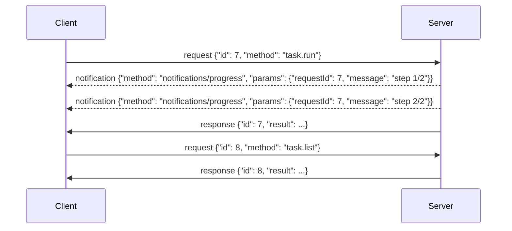

# VirtX Protocol

VirtX is a protocol for running virtual machines, either locally or remotely.

It is inspired by [MCP](https://modelcontextprotocol.io/specification/2026-07-28/basic/transports) (2026-07-28), with some changes.

## Messages

A message is a JSON-RPC 2.0 request, notification or response, encoded as CBOR (RFC 8949) instead of JSON.
It is a CBOR map with text keys, and its members keep the names and meanings JSON-RPC gives them, including `"jsonrpc": "2.0"`.
Examples in this document are written in CBOR diagnostic notation.

Each message is a single CBOR map with nothing after it.
Batches (arrays of messages) are not used: a client MUST NOT send one, and a server MAY refuse one.

Binary data is sent as a CBOR byte string, not encoded as text.

Only the client sends requests.
The server answers them, and MAY send notifications about a request while it runs (see [Notifications](#notifications)).
The server never sends a request.

### Frames

On a byte stream (stdio, or a streamed HTTP response), messages are sent one after another, each as a frame.
A frame is an eight-byte header followed by the message:

```text
d9 d9 f7 5a L L L L
```

`d9 d9 f7` is the self-described CBOR tag (55799), and `5a` starts a byte string with a four-byte length.
`L L L L` is the message's length in bytes, big-endian.
The length always takes the four-byte form, even for a short message, so every header starts with the same four bytes.
A reader finds the next frame by them.
A stream of frames is a CBOR sequence (RFC 8742).

### Requests and responses

The server answers each request with zero or more [notifications](#notifications) about it, then its response, which is always last.
Notifications are for long-running methods, such as `image.build` and `sandbox.exec`, to report their progress.
See [Methods](#methods) for details.



A client MAY have many requests in flight at once.
Responses are matched to requests by `id`, not by order.

### Notifications

While a request runs, the server MAY send its progress, such as a build's output, as `notifications/progress` notifications:

```text
{"jsonrpc": "2.0", "method": "notifications/progress", "params": {"requestId": 7, "message": "pulling alpine:3.20"}}
```

- `requestId` is the `id` of the request the progress is about, exactly as the client sent it. A client tells concurrent requests' progress apart by it, as it does their responses.
- `message` is a string: one line of the request's log, for a person to read.
- A client MUST be ready for a request to have no progress, and MAY ignore what it does not want.
- A notification from the client has no `id`, so the server sends no progress about it.
- The server sends no other notification.
- Over stdio, progress is written to stdout like any other message. Over Streamable HTTP, it goes in that request's `application/cbor-seq` body.

## stdio

The client starts the server as a child process.

- The client writes messages to the server's stdin, and the server writes messages to its stdout, each as a [frame](#frames).
- Neither side writes anything else there: the client MUST NOT to stdin, and the server MUST NOT to stdout. A client SHOULD skip stdout bytes outside a frame, rather than end the session over them.
- The server MAY write UTF-8 text to stderr for a person to read. The client MAY capture, forward or ignore it.
- The client ends the session by closing the server's stdin, which the OS also does when the client's process ends. The server SHOULD then cancel what is in flight and exit, without waiting for those requests to finish. A client MAY kill a server that has not exited within a time it chooses.

## Streamable HTTP

The server offers one HTTP endpoint (for example `https://host/rpc`), and every message is sent to it.
The endpoint accepts only `POST`.
Each `POST` stands alone: there are no sessions, so the server keeps nothing between them for the transport's sake.

### Sending a message

1. Every message from the client is a new `POST` to the endpoint, with `Content-Type: application/cbor` and the message, unframed, as the body.
2. The client MUST send an `Accept` header listing `application/cbor`, and SHOULD also list `application/cbor-seq`. A client that does not list `application/cbor-seq` receives no [notifications](#notifications) over HTTP.
3. If the message is a notification, the server answers `202 Accepted` with no body, or an HTTP error status if it does not accept it.
4. If the message is a request, the server answers `200` with either
   - `Content-Type: application/cbor` and the response, unframed, as the body, or
   - `Content-Type: application/cbor-seq` and the notifications and the response, each as a [frame](#frames) (only to a client that listed it).

   It SHOULD use `application/cbor` when it has no notification to send.
5. An `application/cbor-seq` body ends after the response. A server MUST NOT end it before the response, unless the request was [cancelled](#cancellation).
6. A dropped connection alone is not a cancellation: the server MAY run the request to its end. To cancel, the client sends `notifications/cancelled`.

### Authentication

A server reachable from other machines SHOULD require credentials on every request.
A server on the local machine MAY take none.
The credentials SHOULD be an OAuth 2.1 access token, sent as `Authorization: Bearer <token>`.
How the client obtains the token is outside this protocol.
A server answers `401 Unauthorized` to a request without valid credentials, and `403 Forbidden` to one whose credentials do not allow it.

### Local servers

A server on the local machine SHOULD bind to `127.0.0.1`, not to every interface.
If it takes no credentials, a web page could still reach it through DNS rebinding.
Such a server SHOULD answer `403 Forbidden` to a request whose `Origin` header names an origin it does not allow.
A request with no `Origin`, from any non-browser client, is not refused for that.

## Methods

A method's `params` is a map, and so is its `result` unless the table says otherwise.
A member marked `?` may be left out.
Methods marked with ✓ send [notifications](#notifications) while they run.
Full definitions are in [`src/method/`](src/method/).

### Images

An image is named by the digest of its manifest (`algorithm:hex`), and any number of references (`name:tag`) point at one.
Where a method takes an image, it is `{"type": "reference", "reference": "..."}` or `{"type": "digest", "digest": "..."}`.

| Method | Params | Result | |
| --- | --- | --- | --- |
| `image.list` | | array of `{reference, digest, size}` | |
| `image.pull` | `reference` | `{reference, digest}` | ✓ |
| `image.build` | `recipe`, `reference?` | `{reference, digest}` | ✓ |
| `image.remove` | `image` | `{}` | |

### Snapshots

A snapshot is the upper layer of a sandbox's root filesystem, kept under a name.
A sandbox started on one begins with the changes in it, and writes into it.

| Method | Params | Result | |
| --- | --- | --- | --- |
| `snapshot.list` | | array of `{name, size}` | |
| `snapshot.create` | `name?`, `disk_gib?` | `{name}` | |
| `snapshot.remove` | `name` | `{}` | |
| `snapshot.file.read_dir` | `snapshot`, `path` | array of directory entries | |
| `snapshot.file.read` | `snapshot`, `path`, `offset`, `length?` | `{data}` | |

### Volumes

A volume is storage kept under a name, apart from any sandbox, and mounted into sandboxes.
Remote sources, such as S3 or Google Drive, can be mounted at a path inside one.

| Method | Params | Result | |
| --- | --- | --- | --- |
| `volume.list` | | array of `{name, size}` | |
| `volume.create` | `name?` | `{name}` | |
| `volume.remove` | `name` | `{}` | |
| `volume.file.stat` | `volume`, `path` | metadata | |
| `volume.file.read_dir` | `volume`, `path` | array of directory entries | |
| `volume.file.read` | `volume`, `path`, `offset`, `length?` | `{data}` | |
| `volume.file.write` | `volume`, `path`, `offset?`, `data` | `{}` | |
| `volume.file.create_dir` | `volume`, `path`, `parents` | `{}` | |
| `volume.file.remove` | `volume`, `path`, `recursive` | `{}` | |
| `volume.file.rename` | `volume`, `from`, `to`, `overwrite` | `{}` | |
| `volume.file.copy` | `volume`, `from`, `to`, `overwrite` | `{}` | |
| `volume.mount.list` | `volume` | array of `{path, mount_type}` | |
| `volume.mount.create` | `volume`, `path`, `source` | `{}` | |
| `volume.mount.remove` | `volume`, `path` | `{}` | |

### Sandboxes

A sandbox is a VM booted from an image, optionally on a snapshot, with volumes mounted into it.

| Method | Params | Result | |
| --- | --- | --- | --- |
| `sandbox.list` | | array of `{id, image, snapshot?}` | |
| `sandbox.init` | `image`, `snapshot?`, `network?`, `ports?`, `vcpus?`, `memory_mib?`, `gpu?`, `gpu_memory_mib?`, `volumes?` | `{id, cwd?}` | |
| `sandbox.exec` | `sandbox`, `cmd`, `timeout_ms?` | `{code}` | ✓ |
| `sandbox.close` | `sandbox` | `{}` | |

`sandbox.exec` sends the command's stdout and stderr as its notifications, a line each, and they are sent nowhere else.

## Error

A request that fails is answered with a JSON-RPC error response, in place of a result:

```text
{"jsonrpc": "2.0", "id": 7, "error": {"code": -32602, "message": "missing field `reference`"}}
```

- `code` is an integer, from the table below.
- `message` is a string, for a person to read. A client SHOULD NOT tell errors apart by it.
- `data` is optional, and its contents are up to the server.

| Code | Name | When |
| --- | --- | --- |
| -32700 | Parse error | The message is not one CBOR data item, or something follows it. |
| -32600 | Invalid request | The message is CBOR but not a request: not a map, a batch, `jsonrpc` not `"2.0"`, no `method`, an `id` not a string, integer or null, or `params` not a map or array. |
| -32601 | Method not found | No method has the request's name. |
| -32602 | Invalid params | The params are not what the method takes, such as a missing or unknown member. |
| -32603 | Internal error | The method failed on the server's side, or its result could not be encoded. |

A method MAY answer other codes for its own failures, such as a name already in use or a sandbox that does not exist.
The codes from -32768 to -32000 are reserved by JSON-RPC.

When the server cannot tell the request's `id`, as with a parse error, the response's `id` is `null`.
A notification is never answered, even when it fails.
A response the client sends is ignored, since the server sends no requests.

### Over Streamable HTTP

An error response is still a `200`, carried as any response is.
The server answers with an HTTP error status, and no message, only when it cannot reach the methods:

| Status | When |
| --- | --- |
| `401 Unauthorized`, `403 Forbidden` | See [Authentication](#authentication) and [Local servers](#local-servers). |
| `405 Method Not Allowed` | The HTTP method is not `POST`. |
| `413 Content Too Large` | The body is over the server's limit (10 MiB in this implementation). |
| `500 Internal Server Error` | The server failed before it could answer. |

## Cancellation

A client MAY cancel a request it sent and has no response to yet, by sending a `notifications/cancelled` notification:

```text
{"jsonrpc": "2.0", "method": "notifications/cancelled", "params": {"requestId": 7, "reason": "user interrupted"}}
```

- `requestId` is the `id` of the request to cancel, exactly as the client sent it.
- `reason` is an optional string, for a person to read. The server MAY log it.
- Only the client sends it. The server never cancels a request this way.

Cancellation is for long-running methods, those marked ✓ in [Methods](#methods), such as `image.build` and `sandbox.exec`.
On receiving it, the server SHOULD stop the request and free what it holds, and SHOULD NOT send its response.
What stopping means for each method:

- `image.pull` and `image.build` leave no reference changed. Layers already fetched or built MAY be kept for reuse.
- `sandbox.exec` kills the command, as its `timeout_ms` does. The sandbox stays.

Once it has sent the notification, the client forgets the request.
It SHOULD ignore any progress or response that still arrives for it.

The server MAY ignore a cancellation:

- for a request it does not know, or that has already ended;
- for a method that is not long-running;
- when the request can no longer be stopped.

A request may finish while its cancellation is on the way, so a client MUST be ready for its response anyway.
A cancelled request MAY therefore still have taken effect: a client that needs to know checks, for example with `image.list`.

### Over each transport

Over stdio, the notification is written to stdin like any other message.

Over Streamable HTTP, it is a new `POST`, answered `202 Accepted`.
There is no session to say whose request `requestId` names, so the server matches it only against requests sent with the same credentials, or against all its requests if it takes none.
A client of a server that takes no credentials SHOULD therefore use ids that other clients will not, such as UUIDs.
The client SHOULD also close the connection of the request it cancels, and the server then sends nothing more on it.
