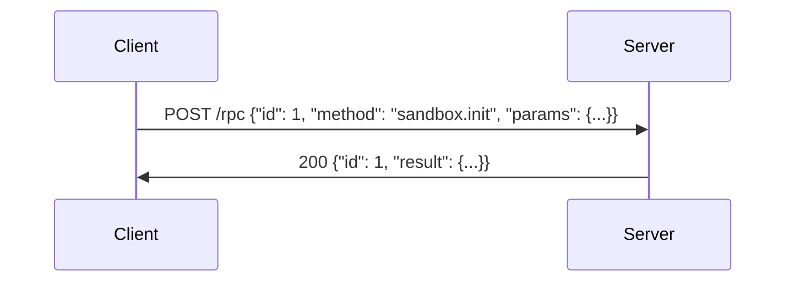
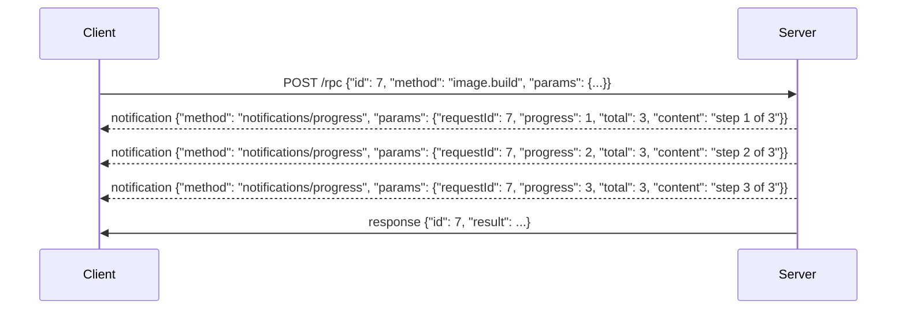

# VirtX Protocol

VirtX is a protocol for running virtual machines, either locally or remotely.

A server offers several endpoints, and each speaks its own protocol:

| Endpoint | Protocol | For |
| --- | --- | --- |
| `/rpc/` | [RPC](#rpc): JSON-RPC 2.0 | Building images, running sandboxes, and managing resources |
| `/images/v2/` | [OCI Distribution](#images) | Image content: manifests, blobs and tags |
| `/volumes/{name}/` | [WebDAV](#files) | The files in a volume |
| `/snapshots/{name}/` | [WebDAV](#files) | The files in a snapshot |

What a thing is and how long it lives is the RPC's.
What it holds is moved with an established protocol, so the RPC carries no bulk data.

Both [transports](#transport) carry HTTP, and every endpoint is reached the same way over either.

## Transport

### HTTP

The server listens on TCP and is reached at a base URL, such as `https://host/`.
Endpoints are paths under it.
The server SHOULD offer HTTP/2, and MAY also offer HTTP/1.1 and HTTP/3.

There are no sessions: the server keeps nothing between requests for the transport's sake.

#### Authentication

A server reachable from other machines SHOULD require credentials on every request, to every endpoint.
A server on the local machine MAY take none.
The credentials SHOULD be an OAuth 2.1 access token, sent as `Authorization: Bearer <token>`.
How the client obtains the token is outside this protocol.
A server answers `401 Unauthorized` to a request without valid credentials, and `403 Forbidden` to one whose credentials do not allow it.

#### Origin

A web page could reach a server through DNS rebinding, so the server MUST check the `Origin` header of every request.
It MUST answer `403 Forbidden` to a request whose `Origin` names an origin it does not allow.
A request with no `Origin`, from any non-browser client, is not refused for that.

#### Local servers

A server on the local machine SHOULD bind to `127.0.0.1`, not to every interface.

### Standard IO (stdio)

The client starts the server as a child process, and the server's stdin and stdout together carry one HTTP/2 connection (RFC 9113), with the client as its client.

- The connection starts with prior knowledge (RFC 9113, section 3.3): the client sends the connection preface first, with no TLS and no upgrade. Requests use the `http` scheme. The authority is not checked.
- Neither side writes anything else there: the client MUST NOT to stdin, and the server MUST NOT to stdout.
- The server MAY write UTF-8 text to stderr for a person to read. The client MAY capture, forward or ignore it.
- The connection is the client's session, and has one client. The server takes no credentials and checks no `Origin`.
- The client ends the session by closing the server's stdin, which the OS also does when the client's process ends. The server SHOULD then cancel what is in flight and exit, without waiting for those requests to finish. A client MAY kill a server that has not exited within a time it chooses.

## RPC

`/rpc` takes JSON-RPC 2.0 requests.
It is inspired by [MCP](https://modelcontextprotocol.io/specification/2026-07-28/basic/transports) (2026-07-28), with some changes.

### Message

A message is a JSON-RPC 2.0 request, notification or response: a JSON object (RFC 8259), in UTF-8.

Each message is a single JSON object with nothing after it.
Batches (arrays of messages) are not used: a client MUST NOT send one, and the server MAY refuse one.

Only the client sends requests.
The server answers them, and MAY send notifications about a request while it runs (see [Stream output](#stream-output)).
The server never sends a request.

#### Event stream

A `text/event-stream` body is a stream of [server-sent events](https://html.spec.whatwg.org/multipage/server-sent-events.html), one message to each event.
An event's `data` is the message, written on one line:

```text
data: {"jsonrpc": "2.0", "method": "notifications/progress", "params": {"requestId": 7, "progress": 1}}

data: {"jsonrpc": "2.0", "id": 7, "result": {"code": 0}}

```

The server sets no other field. A client ignores any other field, and any event with no `data`.

### Sending a message

1. Every message from the client is a new `POST` to `/rpc`, with `Content-Type: application/json` and the message as the body.
2. The client MUST send an `Accept` header listing `application/json`, and SHOULD also list `text/event-stream`. A client that does not list `text/event-stream` receives no [notifications](#stream-output).
3. If the message is a notification, the server answers `202 Accepted` with no body, or an HTTP error status if it does not accept it.
4. If the message is a request, the server answers `200` with either
   - `Content-Type: application/json` and the response as the body, or
   - `Content-Type: text/event-stream` and the notifications and the response, each as an [event](#event-stream) (only to a client that listed it).

   It SHOULD use `application/json` when it has no notification to send.
5. A `text/event-stream` body ends after the response. A server MUST NOT end it before the response, unless the request was [cancelled](#cancellation).



A client MAY have many requests in flight at once.
Responses are matched to requests by `id`, not by order.

### Stream output

While a request runs, the server MAY send notifications about it before its response, such as a build's output.
They are a live view of the request, for as long as the client holds it open: a client that needs what a request did reads it from its result, not from them.



A notification about a request is `notifications/progress`:

```text
{"jsonrpc": "2.0", "method": "notifications/progress", "params": {"requestId": 7, "progress": 3, "total": 5, "content": "RUN apk add git"}}
```

- `requestId` is the `id` of the request it is about, exactly as the client sent it.
- `progress` is an unsigned integer, and MUST increase with each notification about one request. What it counts, such as steps or lines, is the method's.
- `total` is optional: what `progress` will reach, when that is known.
- `content` is optional, and may be any value: what it holds, such as a line of the request's log, is the method's.
- A request's notifications arrive in the order the server sent them, before its response. A client that sees `progress` fail to increase MAY take the request as failed.
- A client MUST be ready for a request to have no notifications, and MAY ignore what it does not want.
- The server sends no other notification.

### Error

A request that fails is answered with a JSON-RPC error response, in place of a result:

```text
{"jsonrpc": "2.0", "id": 7, "error": {"code": -32602, "message": "missing field `recipe`"}}
```

- `code` is an integer, from the table below.
- `message` is a string, for a person to read. A client SHOULD NOT tell errors apart by it.
- `data` is optional, and its contents are up to the server.

| Code | Name | When |
| --- | --- | --- |
| -32700 | Parse error | The body is not one JSON value in UTF-8, or something follows it. |
| -32600 | Invalid request | The message is JSON but not a request: not an object, a batch, `jsonrpc` not `"2.0"`, no `method`, an `id` not a string, integer or null, or `params` not an object or array. |
| -32601 | Method not found | No method has the request's name. |
| -32602 | Invalid params | The params are not what the method takes, such as a missing or unknown member. |
| -32603 | Internal error | The method failed on the server's side, or its result could not be encoded. |

A method MAY answer other codes for its own failures, such as a name already in use or a sandbox that does not exist.
The codes from -32768 to -32000 are reserved by JSON-RPC.

When the server cannot tell the request's `id`, as with a parse error, the response's `id` is `null`.
A notification is never answered, even when it fails.
A response the client sends is ignored, since the server sends no requests.

An error response is still a `200`, carried as any response is.
The server answers with an HTTP error status, and no message, only when it cannot reach the methods:

| Status | When |
| --- | --- |
| `401 Unauthorized`, `403 Forbidden` | See [Authentication](#authentication) and [Origin](#origin). |
| `405 Method Not Allowed` | The HTTP method is not `POST`. |
| `413 Content Too Large` | The body is over the server's limit (10 MiB in this implementation). |
| `500 Internal Server Error` | The server failed before it could answer. |

### Cancellation

A client MAY cancel a request it sent and has no response to yet.
Only the client cancels. The server never cancels a request this way.

Cancellation is for long-running methods, those marked Stream in [Methods](#methods), such as `image.build`, `image.pull`, `image.push` and `sandbox.exec`.
On a cancellation, the server SHOULD stop the request and free what it holds, and SHOULD NOT send its response.
What stopping means for each method:

- `image.build` leaves no tag changed. Layers already built MAY be kept for reuse.
- `image.pull` leaves no tag changed. Blobs already fetched MAY be kept for reuse.
- `image.push` puts no manifest to the other registry. Blobs already pushed there stay.
- `sandbox.exec` kills the command, as its `timeout_ms` does. The sandbox stays.

A client cancels a request in either way:

- It closes the request's connection, or over HTTP/2 or HTTP/3 only its stream. The server MUST treat the close as a cancellation, and MUST NOT send anything more for that request.
- It sends `notifications/cancelled`, as a new `POST` answered `202 Accepted`:

  ```text
  {"jsonrpc": "2.0", "method": "notifications/cancelled", "params": {"requestId": 7, "reason": "user interrupted"}}
  ```

  `requestId` is the `id` of the request to cancel, exactly as the client sent it, and `reason` is an optional string for a person to read.
  The server matches `requestId` against the requests of the same stdio connection, or over HTTP, sent with the same credentials, or against all its requests if it takes none.
  A client of an HTTP server that takes no credentials SHOULD therefore use ids that other clients will not, such as UUIDs.

The request's own `POST` then ends with no response: a `text/event-stream` body ends after what it has sent, and one not yet answered is answered `204 No Content`.

Once it has cancelled the request, the client forgets it.
It SHOULD ignore any progress or response that still arrives for it.

The server MAY ignore a cancellation:

- for a request it does not know, or that has already ended;
- for a method that is not long-running;
- when the request can no longer be stopped.

A request may finish while its cancellation is on the way, so a client MUST be ready for its response anyway.
A cancelled request MAY therefore still have taken effect: a client that needs to know checks.

### Methods

#### Image

| Method | Params | Result | |
| --- | --- | --- | --- |
| `image.pull` | `reference`, `auth?` | `{digest}` | Stream |
| `image.push` | `reference`, `auth?` | `{digest}` | Stream |
| `image.build` | `recipe`, `reference` | `{digest}` | Stream |
| `image.prune` | | `{images, reclaimed}` | |

`image.pull` and `image.push` copy an image between the server's images and another registry, the one `reference` names, as `docker pull` and `docker push` do: `ghcr.io/owner/name:tag` is `owner/name:tag` at `ghcr.io`, and a reference that names no registry, such as `alpine:3.20`, is at Docker Hub.
Each keeps the reference as it is on the server's side, so what `image.pull` pulls is tagged `reference` here, and `image.push` pushes the image `reference` tags here.
Each skips a blob the other side already has, and moves the tag on the receiving side to the image.
`digest` is the digest of the manifest copied; for an image index, the index's own.

`auth` is the credentials for the other registry, as `{"type": "basic", "username", "password"}`, the password possibly an access token the registry takes in its place, or `{"type": "bearer", "token"}`.
Without it the server goes to the registry anonymously.
The server uses `auth` for that request alone: it MUST NOT keep it, write it to a log or a notification, or send it to any other host.

`image.build` builds an image from `recipe` into the server's [images](#images) and tags it `reference`, as a push of it would.

`image.prune` deletes each image no reference points at and no sandbox uses, and what only such images held, such as their layers.
`images` is the digest of each image it deleted, and `reclaimed` how many bytes that freed.
It MAY leave what is too new to tell from what a pull, push or build still in flight will point a reference at.

Everything else about images is done through `/images/v2/`.

#### Snapshot

A snapshot is the upper layer of a sandbox's root filesystem, kept under a name.
A sandbox started on one begins with the changes in it, and writes into it.
Its files are reached at [`/snapshots/{name}/`](#files).

| Method | Params | Result | |
| --- | --- | --- | --- |
| `snapshot.list` | | array of `{name, size, in_use}` | |
| `snapshot.create` | `name?`, `disk_gib?` | `{name}` | |
| `snapshot.remove` | `name` | `{}` | |

`in_use` is whether a sandbox holds the snapshot now, from its `sandbox.init` until its `sandbox.close`.
`snapshot.remove` refuses a snapshot in use.

#### Volume

A volume is storage kept under a name, apart from any sandbox, and mounted into sandboxes.
Remote sources, such as S3 or Google Drive, can be mounted at a path inside one.
Its files are reached at [`/volumes/{name}/`](#files).

| Method | Params | Result | |
| --- | --- | --- | --- |
| `volume.list` | | array of `{name, size}` | |
| `volume.create` | `name?` | `{name}` | |
| `volume.remove` | `name` | `{}` | |
| `volume.mount.list` | `volume` | array of `{path, mount_type}` | |
| `volume.mount.create` | `volume`, `path`, `source` | `{}` | |
| `volume.mount.remove` | `volume`, `path` | `{}` | |

#### Sandbox

A sandbox is a VM booted from an image, optionally on a snapshot, with volumes mounted into it.

| Method | Params | Result | |
| --- | --- | --- | --- |
| `sandbox.list` | | array of `{id, image, snapshot?, running, ports?}` | |
| `sandbox.init` | `image`, `snapshot?`, `network?`, `ports?`, `vcpus?`, `memory_mib?`, `gpu?`, `gpu_memory_mib?`, `volumes?` | `{id, ports?}` | |
| `sandbox.exec` | `sandbox`, `cmd`, `timeout_ms?` | `{code}` | Stream |
| `sandbox.close` | `sandbox` | `{}` | |

`image` in `sandbox.init` is a reference or a digest of an image in the server's [images](#images).

`running` in `sandbox.list` is whether the sandbox's VM is up now. One that is not, such as one whose VM has exited, is still held until `sandbox.close`.

`sandbox.exec` sends the command's output as its notifications, and it is sent nowhere else.
Each line the command writes to stdout or stderr is one notification's `content`: a string, without its line ending, decoded as UTF-8 with each invalid sequence replaced by U+FFFD.
stdout and stderr are not told apart, and lines from the two are in the order the server read them.
A line longer than the server's limit is sent in parts, a notification each.

##### Lifetime

A sandbox belongs to the client that made it, and ends when that client goes: over stdio, with the connection; over HTTP, which has no session, once no request has named it for a time the server chooses.

##### Ports

`ports` are TCP ports in the sandbox to open, as numbers: `[3000, 5900]`.
They are reserved when `sandbox.init` makes the sandbox, and kept until it ends. `0` and a port given twice are refused.

`sandbox.init` answers each with where it is reached from, as `{port, url}`, in the order given; `sandbox.list` answers them again.

- A server on the client's machine answers a loopback address, such as `http://127.0.0.1:54123`, on a port it picks. Only that machine reaches it.
- A server reachable from other machines answers a URL that carries the credentials it needs, and MUST NOT open a port that is reached without them. The URL is as secret as those credentials, and the client MUST keep it so.
- The URL is the server's to form: a client MUST NOT build one or take it apart.
- A connection reaches whatever in the sandbox listens on that port, whichever address it listens on, and is closed when nothing does. Over a remote URL, TCP is carried in a WebSocket to that URL, opened with the subprotocol `virtx.tcp`.
- Ports are the way in, and do not need `network`, which is the way out.

## Images

The server keeps images as an OCI registry, and `/images/v2/` is its API: the [OCI Distribution Specification](https://github.com/opencontainers/distribution-spec/blob/v1.1.1/spec.md) v1.1, with every path the specification roots at `/v2/` rooted at `/images/v2/` instead.
A client gives `/images` as the registry's base path, since tools that assume `/v2/` at the root do not reach it.

The server MUST support the specification's Pull, Push, Content Discovery and Content Management categories.
It also answers `GET /images/v2/_catalog`, which the specification does not define, with the repositories it holds as `{"repositories": [...]}`, paged by `n` and `last` as tag listing is.

- Repository: the name of an image, an OCI repository name such as `alpine` or `team/base`.
- Tag: a name within a repository, such as `3.20`. It points at one manifest, and can be moved to another.
- Reference: a repository and a tag, as `name:tag` (such as `alpine:3.20`).
- Digest: the hash of a manifest, as `algorithm:hex` (such as `sha256:0123abcd...`). It identifies one image's content and never changes. A tag may point at an image index, and a sandbox then boots the manifest in it for the server's platform.

What were image methods are the specification's requests:

| To | Request |
| --- | --- |
| List images | `GET /images/v2/_catalog`, then `GET /images/v2/{name}/tags/list` |
| Tag an image | `PUT /images/v2/{name}/manifests/{tag}` with its manifest |
| Untag a reference | `DELETE /images/v2/{name}/manifests/{tag}` |
| Remove an image | `DELETE /images/v2/{name}/manifests/{digest}`, which also removes every tag pointing at it |
| Export an image | `GET` its manifest, and each blob it names |
| Import an image | Push each blob, then `PUT` its manifest by tag |

A manifest no tag points at, and a blob no manifest names, MAY be deleted by the server at any time.
A client pushing an image therefore puts its manifest by tag, not by digest alone.

The server copies images to and from other registries with [`image.pull` and `image.push`](#image), which take that registry's credentials.
A client that would rather keep them can copy an image itself instead: it fetches the image from that registry and pushes it here, skipping each blob a `HEAD` shows the server already has, or the other way round.

A request that fails is answered with the specification's error codes, in its `{"errors": [...]}` body.

## Files

The files in a volume are reached at `/volumes/{name}/`, and those in a snapshot at `/snapshots/{name}/`, with [WebDAV](https://www.rfc-editor.org/rfc/rfc4918) (RFC 4918).
The path after the root is the file's path in the volume or snapshot, each segment percent-encoded.

The server MUST support WebDAV class 1, and MAY support class 2 (locking).

| To | Request |
| --- | --- |
| Read metadata | `PROPFIND`, `Depth: 0` |
| List a directory | `PROPFIND`, `Depth: 1` |
| Read a file | `GET`, with `Range` for a part of it |
| Write a file | `PUT` |
| Create a directory | `MKCOL` |
| Remove | `DELETE` |
| Rename | `MOVE`, with `Overwrite` |
| Copy | `COPY`, with `Overwrite` |

- `PROPFIND` answers at least `resourcetype`, `getcontentlength` and `getlastmodified`. The server MAY refuse `Depth: infinity`, as RFC 4918 lets it.
- `PUT` replaces the whole file, and creates it if it does not exist. A `PUT` with `Content-Range` is refused with `400 Bad Request`: a file is written whole.
- `PUT` and `MKCOL` under a directory that does not exist are refused with `409 Conflict`, as RFC 4918 says. `MKCOL` creates one directory, not its parents.
- `DELETE` of a directory removes everything in it.
- `MOVE` and `COPY` take a `Destination` in the same volume or snapshot, and refuse any other with `502 Bad Gateway`.
- A request naming a volume or snapshot that does not exist is answered `404 Not Found`.

In a volume, a remote source mounted at a path is reached at that path, and a request under it goes to the source. It fails, with the status the server chooses, where the source cannot do it, such as a `MOVE` the source does not support.

A snapshot in use, held by a sandbox from its `sandbox.init` until its `sandbox.close`, is answered `423 Locked` to every request, reads included: its files are the sandbox's until then.
