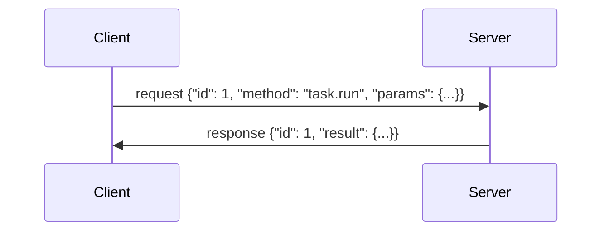
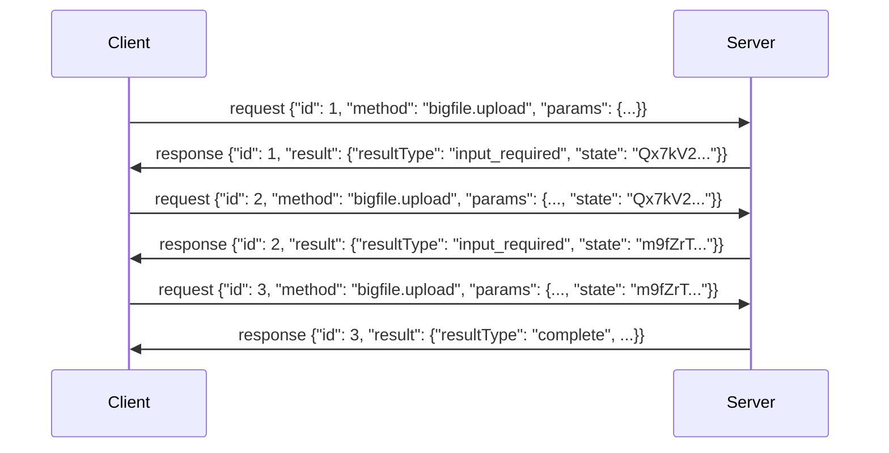
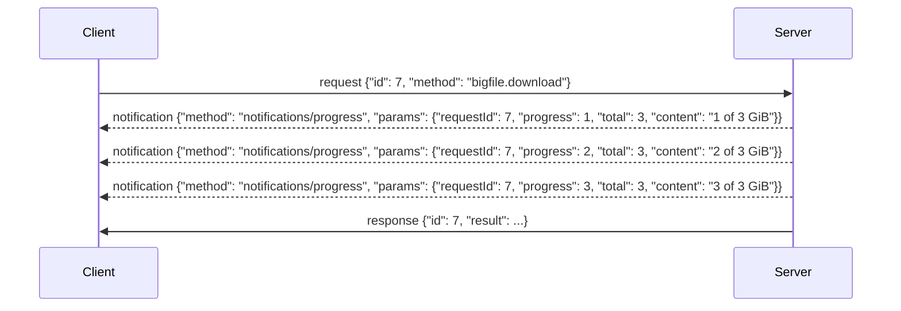

# VirtX Protocol

VirtX is a protocol for running virtual machines, either locally or remotely.

It is inspired by [MCP](https://modelcontextprotocol.io/specification/2026-07-28/basic/transports) (2026-07-28), with some changes.

## Message

A message is a JSON-RPC 2.0 request, notification or response, encoded as CBOR (RFC 8949) instead of JSON.
It is a CBOR map with text keys, and its members keep the names and meanings JSON-RPC gives them, including `"jsonrpc": "2.0"`.
Examples in this document are written in CBOR diagnostic notation.

Each message is a single CBOR map with nothing after it.
Batches (arrays of messages) are not used: a client MUST NOT send one, and a server MAY refuse one.

Binary data is sent as a CBOR byte string, not encoded as text.

Only the client sends requests.
The server answers them, and MAY send notifications about a request while it runs (see [Stream output](#stream-output)).
The server never sends a request.

### Frame

On a byte stream (stdio, or a streamed HTTP response), messages are sent one after another, each as a frame.
A frame is an eight-byte header followed by the message:

```text
d9 d9 f7 5a L L L L
```

`d9 d9 f7` is the self-described CBOR tag (55799), and `5a` starts a byte string with a four-byte length.
`L L L L` is the message's length in bytes, big-endian.
The length always takes the four-byte form, even for a short message, so every header starts with the same four bytes.
A reader finds the next frame by them.
A stream of frames is a CBOR sequence (RFC 8742).

### Request and response

A request and its response follow JSON-RPC, as [Message](#message) says.



A client MAY have many requests in flight at once.
Responses are matched to requests by `id`, not by order.

A request too large for one message, or too long to wait on, follows one of the patterns below, and a method that does says which.

#### Multi round-trip requests (MRTR)

A method that takes more than one message can carry SHOULD take it over several requests, rather than holding a session or a stream open for it (reference: [MCP](https://modelcontextprotocol.io/specification/2026-07-28/basic/patterns/mrtr)).



- When the server needs more before it can finish, it answers `resultType: "input_required"`, with a `state`. The client sends the same method again, as a new request with a new `id`, with what the method asks for next and that `state`, exactly as it was given.
- Each request stands alone: what ties them together is `state`, so the server holds no session for them.
- `state` is a string only the server reads. A client MUST NOT inspect or change it.
- A server MUST treat `state` as the client's input, which an attacker may have forged: it MUST protect it from being forged or altered, such as with an HMAC or AEAD, and SHOULD bind into it the credentials it was given to, an expiry, and the request it continues.
- A `state` that fails the server's check, or has expired, is answered with an error, and the client starts over.
- What else an `input_required` result carries, and what the client sends next, is the method's.

#### Stream output

While a request runs, the server MAY send notifications about it before its response, such as a build's output.
They are a live view of the request, for as long as the client holds it open: a client that needs what a request did reads it from its result or its task, not from them.
The exception is a method whose output is too large for one message, such as `image.export`: it sends that output in its notifications' `content`, and says so.



A notification about a request is `notifications/progress`:

```text
{"jsonrpc": "2.0", "method": "notifications/progress", "params": {"requestId": 7, "progress": 3, "total": 5, "content": "pulling alpine:3.20"}}
```

- `requestId` is the `id` of the request it is about, exactly as the client sent it. A client tells concurrent requests' notifications apart by it, as it does their responses.
- `progress` is an unsigned integer, and MUST increase with each notification about one request. What it counts, such as steps or bytes, is the method's.
- `total` is optional: what `progress` will reach, when that is known.
- `content` is optional, and may be any value: what it holds, such as a line of the request's log or the next piece of its output, is the method's.
- A method that sends its output in `content` sends it as byte strings, each the next piece of it. `progress` then counts bytes, those sent so far including this piece, so a client that sees it differ from what it has received takes the request as failed. Over Streamable HTTP, a client that does not accept `application/cbor-seq` cannot receive it, and the server answers such a method with an error.
- A request's notifications arrive in the order the server sent them, before its response. A client that sees `progress` fail to increase MAY take the request as failed.
- A client MUST be ready for a request to have no notifications, and MAY ignore what it does not want.
- A notification from the client has no `id`, so the server sends no progress about it.
- The server sends no other notification.
- Over stdio, progress is written to stdout like any other message. Over Streamable HTTP, it goes in that request's `application/cbor-seq` body.

## Standard IO(stdio) protocol

The client starts the server as a child process.

- The client writes messages to the server's stdin, and the server writes messages to its stdout, each as a [frame](#frames).
- Neither side writes anything else there: the client MUST NOT to stdin, and the server MUST NOT to stdout. A client SHOULD skip stdout bytes outside a frame, rather than end the session over them.
- The server MAY write UTF-8 text to stderr for a person to read. The client MAY capture, forward or ignore it.
- The client ends the session by closing the server's stdin, which the OS also does when the client's process ends. The server SHOULD then cancel what is in flight and exit, without waiting for those requests to finish. A client MAY kill a server that has not exited within a time it chooses.

## Streamable HTTP protocol

The server offers one HTTP endpoint (for example `https://host/rpc`), and every message is sent to it.
The endpoint accepts only `POST`.
Each `POST` stands alone: there are no sessions, so the server keeps nothing between them for the transport's sake.

### Sending a message

1. Every message from the client is a new `POST` to the endpoint, with `Content-Type: application/cbor` and the message, unframed, as the body.
2. The client MUST send an `Accept` header listing `application/cbor`, and SHOULD also list `application/cbor-seq`. A client that does not list `application/cbor-seq` receives no [notifications](#stream-output) over HTTP.
3. If the message is a notification, the server answers `202 Accepted` with no body, or an HTTP error status if it does not accept it.
4. If the message is a request, the server answers `200` with either
   - `Content-Type: application/cbor` and the response, unframed, as the body, or
   - `Content-Type: application/cbor-seq` and the notifications and the response, each as a [frame](#frames) (only to a client that listed it).

   It SHOULD use `application/cbor` when it has no notification to send.
5. An `application/cbor-seq` body ends after the response. A server MUST NOT end it before the response, unless the request was [cancelled](#cancellation).
6. A connection closed before the response is a [cancellation](#cancellation) of its request, and the server MUST treat it as one.

### Authentication

A server reachable from other machines SHOULD require credentials on every request.
A server on the local machine MAY take none.
The credentials SHOULD be an OAuth 2.1 access token, sent as `Authorization: Bearer <token>`.
How the client obtains the token is outside this protocol.
A server answers `401 Unauthorized` to a request without valid credentials, and `403 Forbidden` to one whose credentials do not allow it.

### Origin

A web page could reach a server through DNS rebinding, so the server MUST check the `Origin` header of every request.
It MUST answer `403 Forbidden` to a request whose `Origin` names an origin it does not allow.
A request with no `Origin`, from any non-browser client, is not refused for that.

### Local servers

A server on the local machine SHOULD bind to `127.0.0.1`, not to every interface.

## Methods

### Image

- Digest: the name of an image, the hash of its manifest, as `algorithm:hex` (such as `sha256:0123abcd...`). It identifies one image's content and never changes.
- Reference: a name a person gives an image, as `name:tag` (such as `alpine:3.20`). It points at one image, and can be moved to another. Any number of references may point at one image.

An image no reference points at any more is forgotten, whichever method took its last reference.

| Method | Params | Result | |
| --- | --- | --- | --- |
| `image.list` | | array of `{reference, digest, size}` | |
| `image.pull` | `reference`, `auth?` | `{digest}` | Stream |
| `image.build` | `recipe`, `reference` | `{digest}` | Stream |
| `image.tag` | `image`, `reference` | `{digest}` | |
| `image.untag` | `reference` | `{}` | |
| `image.remove` | `digest` | `{}` | |
| `image.export` | `reference` | `{digest, size}` | Stream |
| `image.import` | `size`, `data`, `state?`, `reference` | `{digest}` | MRTR |

A reference already in use is moved to the image `image.pull`, `image.build`, `image.tag` or `image.import` points it at.
Cancelled, none of them leaves a reference changed.

`auth` in `image.pull` is the registry's credentials, tagged by `type`: `{type: "basic", username, password}` or `{type: "bearer", token}`. Without it the server pulls anonymously.

`image` in `image.tag` is tagged by `type`, `{type: "reference", reference}` or `{type: "digest", digest}`, since `sha256:0123abcd` reads as both a digest and the reference `sha256` at tag `0123abcd`.

`image.export` sends the image as an OCI image layout in a tar, in its notifications: each `content` a byte string, the next piece of the archive, with `progress` the bytes sent so far and `total` the archive's length.

`image.import` takes the same archive a piece per request. Until it holds the whole archive it answers `{resultType: "input_required", state, received, due_time}`, and the client sends the next piece, from byte `received`, with that `state`, before `due_time`.

### Snapshot

A snapshot is the upper layer of a sandbox's root filesystem, kept under a name.
A sandbox started on one begins with the changes in it, and writes into it.

| Method | Params | Result | |
| --- | --- | --- | --- |
| `snapshot.list` | | array of `{name, size}` | |
| `snapshot.create` | `name?`, `disk_gib?` | `{name}` | |
| `snapshot.remove` | `name` | `{}` | |
| `snapshot.file.stat` | `snapshot`, `path` | metadata | |
| `snapshot.file.read_dir` | `snapshot`, `path` | array of directory entries | |
| `snapshot.file.read` | `snapshot`, `path`, `offset`, `length?` | `{data}` | |

### Volume

A volume is storage kept under a name, apart from any sandbox, and mounted into sandboxes.
Remote sources, such as S3 or Google Drive, can be mounted at a path inside one.

| Method | Params | Result | |
| --- | --- | --- | --- |
| `volume.list` | | array of `{name, size}` | |
| `volume.create` | `name?` | `{name}` | |
| `volume.remove` | `name` | `{}` | |
| `volume.file.stat` | `volume`, `path` | metadata | |
| `volume.file.read_dir` | `volume`, `path` | array of directory entries | |
| `volume.file.read` | `volume`, `path`, `offset`, `length?` | `{data}` | |
| `volume.file.write` | `volume`, `path`, `offset?`, `data` | `{}` | |
| `volume.file.create_dir` | `volume`, `path`, `parents` | `{}` | |
| `volume.file.remove` | `volume`, `path`, `recursive` | `{}` | |
| `volume.file.rename` | `volume`, `from`, `to`, `overwrite` | `{}` | |
| `volume.file.copy` | `volume`, `from`, `to`, `overwrite` | `{}` | |
| `volume.mount.list` | `volume` | array of `{path, mount_type}` | |
| `volume.mount.create` | `volume`, `path`, `source` | `{}` | |
| `volume.mount.remove` | `volume`, `path` | `{}` | |

### Sandbox

A sandbox is a VM booted from an image, optionally on a snapshot, with volumes mounted into it.

| Method | Params | Result | |
| --- | --- | --- | --- |
| `sandbox.list` | | array of `{id, image, snapshot?, running, daemon?, ports?}` | |
| `sandbox.init` | `image`, `snapshot?`, `network?`, `daemon?`, `ports?`, `vcpus?`, `memory_mib?`, `gpu?`, `gpu_memory_mib?`, `volumes?` | `{id, cwd?, ports?}` | |
| `sandbox.exec` | `sandbox`, `cmd`, `timeout_ms?` | `{code}` | Stream |
| `sandbox.close` | `sandbox` | `{}` | |

`running` in `sandbox.list` is whether the sandbox's VM is up now. One that is not, such as one whose VM has exited, is still held until `sandbox.close`.

#### Daemon

A sandbox belongs to the client that made it, and ends when that client goes: over stdio, with the session; over Streamable HTTP, which has no session, once no request has named it for a time the server chooses.
With `daemon: true` it is kept until `sandbox.close` instead, whatever becomes of that client, and any client of the server can reach it by its id.
A server that cannot keep one, such as a stdio server that exits with its session, refuses `daemon: true`.

#### Ports

`ports` are TCP ports in the sandbox to open, as numbers: `[3000, 5900]`.
They are only for a daemon: `ports` without `daemon: true` is refused, and so are `0` and a port given twice.

`sandbox.init` answers each with where it is reached from, as `{port, url}`, in the order given; `sandbox.list` answers them again for a daemon.

- A server on the client's machine answers a loopback address, such as `http://127.0.0.1:54123`, on a port it picks. Only that machine reaches it.
- A server reachable from other machines answers a URL that carries the credentials it needs, and MUST NOT open a port that is reached without them. The URL is as secret as those credentials, and the client MUST keep it so.
- The URL is the server's to form: a client MUST NOT build one or take it apart.
- A connection reaches whatever in the sandbox listens on that port, whichever address it listens on, and is closed when nothing does. Over a remote URL, HTTP is proxied to it as it is, and any other TCP is carried in a WebSocket to the same URL, opened with the subprotocol `virtx.tcp`.
- Ports are the way in, and do not need `network`, which is the way out.

`sandbox.exec` sends the command's stdout and stderr as its notifications, a line each, and they are sent nowhere else.

## Error

A request that fails is answered with a JSON-RPC error response, in place of a result:

```text
{"jsonrpc": "2.0", "id": 7, "error": {"code": -32602, "message": "missing field `reference`"}}
```

- `code` is an integer, from the table below.
- `message` is a string, for a person to read. A client SHOULD NOT tell errors apart by it.
- `data` is optional, and its contents are up to the server.

| Code | Name | When |
| --- | --- | --- |
| -32700 | Parse error | The message is not one CBOR data item, or something follows it. |
| -32600 | Invalid request | The message is CBOR but not a request: not a map, a batch, `jsonrpc` not `"2.0"`, no `method`, an `id` not a string, integer or null, or `params` not a map or array. |
| -32601 | Method not found | No method has the request's name. |
| -32602 | Invalid params | The params are not what the method takes, such as a missing or unknown member. |
| -32603 | Internal error | The method failed on the server's side, or its result could not be encoded. |

A method MAY answer other codes for its own failures, such as a name already in use or a sandbox that does not exist.
The codes from -32768 to -32000 are reserved by JSON-RPC.

When the server cannot tell the request's `id`, as with a parse error, the response's `id` is `null`.
A notification is never answered, even when it fails.
A response the client sends is ignored, since the server sends no requests.

### Over Streamable HTTP

An error response is still a `200`, carried as any response is.
The server answers with an HTTP error status, and no message, only when it cannot reach the methods:

| Status | When |
| --- | --- |
| `401 Unauthorized`, `403 Forbidden` | See [Authentication](#authentication) and [Origin](#origin). |
| `405 Method Not Allowed` | The HTTP method is not `POST`. |
| `413 Content Too Large` | The body is over the server's limit (10 MiB in this implementation). |
| `500 Internal Server Error` | The server failed before it could answer. |

## Cancellation

A client MAY cancel a request it sent and has no response to yet, in the way its [transport](#over-each-transport) gives.
Only the client cancels. The server never cancels a request this way.

Cancellation is for long-running methods, those marked Stream in [Methods](#methods), such as `image.build` and `sandbox.exec`.
On a cancellation, the server SHOULD stop the request and free what it holds, and SHOULD NOT send its response.
What stopping means for each method:

- `image.pull` and `image.build` leave no reference changed. Layers already fetched or built MAY be kept for reuse.
- `image.export` changes nothing, and what the client received of the archive is incomplete.
- `image.import` is long-running only in the request that completes it. Cancelling that one leaves no reference changed; a client stops an import before it by sending no more.
- `sandbox.exec` kills the command, as its `timeout_ms` does. The sandbox stays.

Once it has cancelled the request, the client forgets it.
It SHOULD ignore any progress or response that still arrives for it.

The server MAY ignore a cancellation:

- for a request it does not know, or that has already ended;
- for a method that is not long-running;
- when the request can no longer be stopped.

A request may finish while its cancellation is on the way, so a client MUST be ready for its response anyway.
A cancelled request MAY therefore still have taken effect: a client that needs to know checks, for example with `image.list`.

### Over each transport

Over stdio, the client writes a `notifications/cancelled` notification to stdin like any other message:

```text
{"jsonrpc": "2.0", "method": "notifications/cancelled", "params": {"requestId": 7, "reason": "user interrupted"}}
```

- `requestId` is the `id` of the request to cancel, exactly as the client sent it.
- `reason` is an optional string, for a person to read. The server MAY log it.

Over Streamable HTTP, either cancels a request:

- The client closes the request's connection (over HTTP/2 or HTTP/3, only its stream). The server MUST treat the close as a cancellation, and MUST NOT send anything more for that request.
- The client sends `notifications/cancelled`, as a new `POST` answered `202 Accepted`. MCP defines no notification from the client over Streamable HTTP; this protocol adds it, so a client can cancel a request without closing its connection.
  There is no session to say whose request `requestId` names, so the server matches it only against requests sent with the same credentials, or against all its requests if it takes none.
  A client of a server that takes no credentials SHOULD therefore use ids that other clients will not, such as UUIDs.
